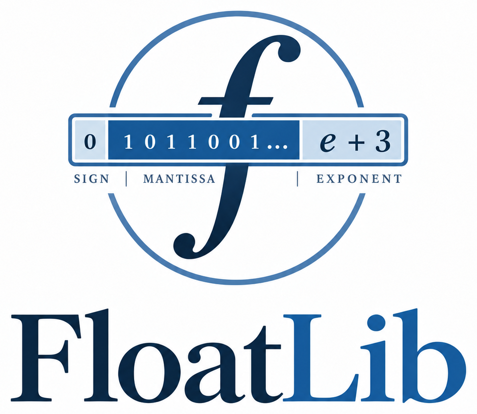

<h1 align="center">
  
  Verified Floating-Point Arithmetic in Lean
</h1>

FloatLib is a Lean library for arbitrary precision floating-point arithmetic with
machine-checked proofs, and we built it so the code you run is the code you prove things about.
Ask binary32 for `0.1 + 0.2` and it prints `0.3`. Ask for the exact value it stored and you get
`5033165 / 16777216`, a hair above three tenths, which binary32 can't hold exactly. And the
addition that produced it is the one the theorem talks about, whichever backend the planner
picked. You pick a numerical format, write ordinary arithmetic with it, and those theorems are
there to use anywhere in your Lean development.

It covers IEEE binary and decimal, posits with exact quire accumulation, and the small formats
people use in ML. Have a different format in mind? You can define it yourself on top of the
shared integer kernels and rounding theory. We follow the standard literature down to the
details that bite in real programs: rounding modes, NaNs, infinities and both signed zeros.

Our [guide](site/content/chapters) works through calculations, proofs and the algorithms behind
them, and its [first chapter](site/content/chapters/01-using-the-library.md) is the place to
start.

## Installation

From a checkout of this repository, fetch the Mathlib cache and build FloatLib:

```bash
lake exe cache get
lake build
```

Use the Lean version in [lean-toolchain](lean-toolchain). Everything else is pinned in
[lake-manifest.json](lake-manifest.json), so you get the same dependency versions we use.

In your own Lake project, add FloatLib with `require`:

```lean
require floatlib from git
  "https://github.com/lean-dojo/FloatLib.git" @ "main"
```

Then run `lake update`, `lake exe cache get` and `lake build`. For the toolchain and your
first file, see the
[project setup instructions](site/content/chapters/01-using-the-library.md#how-to-set-up-a-project).

## A calculation and a proof

Here's the whole idea in a few lines. It picks binary32, adds two numbers, and proves that the
executable addition returns the specification's result. Save it as `Main.lean` in the
repository and run `lake env lean Main.lean`:

```lean
import FloatLib

open FloatLib.Floats

#float_info Binary32

def x : Binary32 := 1.5
def y : Binary32 := 2.25

#eval x + y

example : x + y = ExecFloat.Spec.add x y :=
  ExecFloat.Proof.add_eq_spec x y
```

The sum is `3.75`. Nothing was lost to rounding, because 1.5, 2.25 and 3.75 are all short
binary fractions. That's one run on two numbers, but `add_eq_spec` holds for any operands, and
it pins down the whole result word, right down to how an exceptional value or a signed zero is
encoded. So what you get is an equation you can use inside a larger proof. And `#float_info` at
the top shows the chosen representation, its backends and the theorems available for it.

A bound on rounding error takes more than the result bits. It needs assumptions about the
format, finiteness and range, and we work through those in the
[guide](site/content/chapters/01-using-the-library.md) together with directed rounding,
exception flags, intervals and accumulation. Or take one of the [examples](FloatLib/Examples)
and adapt it to your own calculation.

## What you can work with

- **IEEE binary and decimal.** Binary arithmetic handles subnormals, signed zeros, infinities,
  NaNs, rounding modes and status flags. Decimal32, decimal64 and decimal128 come in both the
  BID and DPD encodings, with arithmetic, conversions and rounding proofs.
- **Posits and quires.** Pick a total width with `ExecFloat.Posit (bits := n)`. Its quire,
  `ExecFloat.Posit.Quire (bits := n)`, is an exact accumulator: it adds up products with no
  rounding as long as they fit its capacity, and rounds once at the end. We follow the 2022
  posit standard.
- **Small and custom formats.** FP8, FP6, FP4, OCP MX blocks, fixed point, logarithmic and
  codebook representations all share the same numerical interfaces. P3109 gets
  [its own chapter](site/content/chapters/07-low-precision-formats-for-machine-learning.md#what-is-ieee-p3109), which explains the working group's
  format rules and the report our implementation follows.
- **Classical rounding results.** Correct rounding, half-ulp error bounds and Sterbenz's
  exact-subtraction lemma tie the real-valued theory to the arithmetic that runs.
  Mixed-precision bounds cover casts, products and accumulator updates, under their stated
  finiteness assumptions.
- **The `roundoff` tactic.** With the `Automation.Roundoff` import, the tactic proves error
  bounds for configured computations, loops over lists, arrays, vectors and matrices included.
  Underneath, `MixedError` carries a relative and an absolute error through binary operations,
  casts and sums. The `roundoff theorem` and `roundoff mixed theorem` commands go a step
  further and write the theorem and its proof for you, stating the range conditions they need.
  See the
  [roundoff guide](site/content/chapters/11-proving-numerical-bounds.md#how-to-get-an-error-bound-for-floating-point-code).
- **Intervals and affine quantization.** One interval API takes binary, decimal, posit and
  custom endpoints, each with a stated outward-rounding contract. The
  [`interval` tactic](site/content/chapters/11-proving-numerical-bounds.md) proves real
  inequalities, elementary functions included, by certified evaluation and subdivision. Affine
  quantization has a real-valued specification with a rounding rule you supply, plus a proof
  connecting nearest-even quantization to the executable rational implementation.
- **Bounds from coefficients.** The same `interval` tactic proves bounds over a whole domain from
  coefficients: trigonometric polynomials with cosine and sine terms on the circle, polynomials
  and Chebyshev series on any interval, and norms of polynomials on the unit circle of `ℂ`, with
  rational coefficients or the exact values of float data. Lean's kernel checks sum-of-squares
  certificates on packed rows, lists of integers kept in one big number so that a product or an
  `l1` norm takes a few big-number operations, and a posteriori defects give inverses and inverse
  square roots of such polynomials. See
  [the coefficient guide](site/content/chapters/11-proving-numerical-bounds.md#how-to-bound-a-polynomial-on-the-whole-circle).
- **Repeatedly rounded sums.** A reduction tree fixes the order of the additions, and its error
  bounds account for rounding at every node, absolute-error terms near underflow included. For
  a sum that rounds only once, use the exact accumulators.
- **Elementary functions and complex numbers.** Posit elementary functions are proved to return
  the correctly rounded real result. For IEEE binary formats, `ExecFloat.Binary.Certified.exp`,
  `log`, `pow`, `expMinus1` and `logPlus1` return a correctly rounded finite result when
  rational enclosure refinement succeeds, and tell you why when it doesn't. Import
  `Configured.CorrectlyRounded` and you get total `ExecFloat.Binary.CorrectlyRounded.exp`,
  `log`, `expMinus1`, `logPlus1` and `expMul`, correctly rounded on IEEE formats with no
  premise on the search budget. `Configured.Transcendentals` brings deterministic
  approximations for a wider set of binary functions. We haven't proved general error bounds
  for those approximation kernels, but they match MPFR on every case of the elementary-function
  test tiers. Sine and cosine can return an invalid result if they run out of
  argument-reduction budget. For IEEE-style descriptors, that import's `pow` of a positive base
  is correctly rounded whenever its enclosure search settles, and its `pi` is correctly
  rounded. `ExecComplex` gives you arithmetic on pairs of binary components, with theorems that
  track the scalar rounding. You can see them in use in the
  [examples](FloatLib/Examples/Transcendentals.lean) and the
  [complex section](site/content/chapters/05-ieee-binary-formats.md#how-to-work-with-complex-numbers).

Our [theorem index](FloatLib/Floats/THEOREMS.md) collects the major theorems. Like other
formalization projects, we keep a [formalization.yaml](formalization.yaml) that lists the
mathematical sources, scope, and key results. It also says how we used AI: we spent several
months planning the library and building its foundations, and Codex helped us finish some of
the proofs and optimize the arithmetic backends.

## Speed and independent checks

We've put a lot of work into making the proved arithmetic fast, because we want MPFR's speed
without giving up the connection between the arithmetic and its proofs. In October, for
example, we found that binary128 spent nearly all of each operation splitting and joining GMP
numbers, so we moved it onto two machine words with kernels of its own. The
[planner](site/content/chapters/12-performance.md) picks among lookup tables, word
kernels and wider limb algorithms, and every certified choice has to prove that it agrees with
the same specification. You can set the backend policy yourself, too. There's also a host-FPU
path, but it's unchecked and you have to call it by name.

On ordinary binary64 calls, FloatLib's proved addition, subtraction and multiplication beat
MPFR at the same precision, multiplication by about 2.4 times. Our
[benchmarks](site/content/chapters/12-performance.md) compare scalar operations from 2 to 4,096
bits, so you can see where the kernels win and where MPFR is faster. Lean checks the proofs
before anything runs and erases them when it compiles, so they cost nothing at runtime. Want a
second opinion? Run the opt-in command
`FLOATLIB_RUN_INDEPENDENT_CHECKER=1 bash tests/verify.sh` and it also replays the compiled
FloatLib declarations through Lean's kernel with `leanchecker`.

A proof only shows that the code matches the specification we wrote, so we test the
specifications too, against other people's implementations. Our saved runs matched Berkeley
TestFloat on **more than 102 million cases** for the IEEE formats and operations we tested, and
other comparisons cover MPFR, decimal arithmetic, small-format tables and posits. Our
comparisons with MPFX found four bugs in that library, which we've reported upstream. SoftPosit
disagrees with us on a small set of boundary cases, and
[the analysis](site/content/chapters/14-external-validation.md#why-did-softposit-disagree-with-floatlib) works
through the calculations behind each side.

You can reproduce the external comparisons with the [testing guide](tests/README.md), or
measure your own machine with the [benchmark guide](benchmarks/docs/Comparison.md).

## Source files

To follow an operation down into its implementation and proof, start from the three main parts
of the library:

| Directory | What belongs here |
| --- | --- |
| [`FloatLib/Numerics`](FloatLib/Numerics) | Representation-independent meaning, exact arithmetic, contracts, enclosures, packed rows for kernel certificates, and coefficient bounds |
| [`FloatLib/Kernels`](FloatLib/Kernels) | Shared word and limb algorithms with refinement proofs |
| [`FloatLib/Floats`](FloatLib/Floats) | Concrete formats, real-valued rounding theory, executable operations, and their proofs |

Tests and benchmarks live in their own Lake workspaces, so importing the library never pulls
them in. The [website](site/) holds the guide, checked Lean examples, references, and
dependency graphs that show how the definitions and proofs fit together.

## Contributing

Thanks for your interest in FloatLib. If you have a format you want to add, a kernel you think
could be faster, or a proof that could be simpler, we'd love to hear from you. FloatLib builds
on Mathlib and follows its proof style and naming conventions, and the
[contributing guide](CONTRIBUTING.md) explains how to get started.

For a local check of the library and website:

```bash
bash tests/verify.sh     # build the library and run its checks
bash site/build.sh       # build the guide and check its examples
```

## License and credits

Thanks to the Lean, Mathlib, and Flocq communities, and to the authors of the libraries
used in our comparisons.

FloatLib's own code is [MIT licensed](LICENSE). See [third-party licenses](third_party/README.md)
for external code, data, and fonts.
