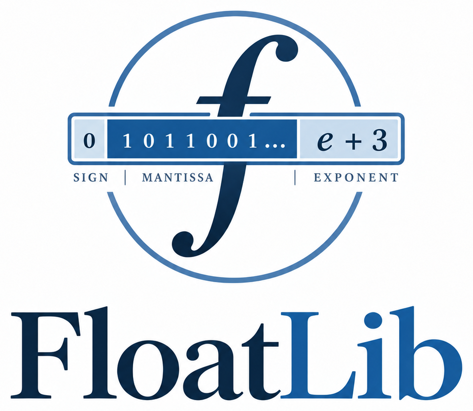

<h1 align="center">
  
  Verified Floating-Point Arithmetic in Lean
</h1>

FloatLib is a Lean library for arbitrary precision floating point arithmetic with
machine-checked proofs. We built it so the code you run is the code you prove things about.
Pick a numerical format, write ordinary arithmetic, and use theorems about those operations
anywhere in your Lean development.

It covers IEEE binary and decimal, posits with exact quire accumulation, and the small
formats people use in ML. If you have a different format in mind, you can define it yourself
and build on the shared integer kernels and rounding theory. We follow the standard
literature down to the details that matter in real programs: rounding modes, NaNs,
infinities, and both signed zeros.

In [the guide](site/content/chapters), we work through calculations, proofs, and the
algorithms behind them. Start with the
[first chapter](site/content/chapters/01-using-the-library.md).

## Installation

From a checkout of this repository, fetch the Mathlib cache and build FloatLib:

```bash
lake exe cache get
lake build
```

Use the Lean version in [lean-toolchain](lean-toolchain).
[lake-manifest.json](lake-manifest.json) already pins the dependency versions we use. If
you're adding FloatLib to an existing Lean project, follow the
[project setup instructions](site/content/chapters/01-using-the-library.md#setting-up-a-project).

## A calculation and a proof

Here's a small example you can both run and reason about. It picks binary32, adds two
numbers, and proves that the executable addition returns the specification's result. Save it
as `Main.lean` in the repository and run `lake env lean Main.lean`:

```lean
import FloatLib

open FloatLib.Floats

#float_info Binary32

def x : Binary32 := 1.5
def y : Binary32 := 2.25

#eval x + y

example : x + y = ExecFloat.Spec.add x y :=
  ExecFloat.Proof.add_eq_spec x y
```

The sum is exactly `3.75`. We ran it on two particular numbers, but `add_eq_spec` holds for
any operands, and it pins down the whole result word, including how an exceptional value or
a signed zero is encoded. So you get an equation you can use inside a larger proof.
`#float_info` shows the chosen representation, its backends, and the theorems available for
it.

To get from result bits to a bound on rounding error, you also need assumptions about the
format, finiteness, and range, and we work through those in the
[guide](site/content/chapters/01-using-the-library.md) together with directed rounding,
exception flags, intervals, and accumulation. Or take one of the
[examples](FloatLib/Examples) and adapt it to your own calculation.

## What you can work with

- **IEEE binary and decimal.** Binary arithmetic handles subnormals, signed zeros,
  infinities, NaNs, rounding modes, and status flags. Decimal32, decimal64, and decimal128
  come in both BID and DPD encodings, with arithmetic, conversions, and rounding proofs.
- **Posits and quires.** Pick a total width with `ExecFloat.Posit (bits := n)`. A quire,
  `ExecFloat.Posit.Quire (bits := n)`, accumulates products exactly up to its capacity and
  rounds once at the end. We follow the 2022 posit standard.
- **Small and custom formats.** FP8, FP6, FP4, OCP MX blocks, fixed point, logarithmic, and
  codebook representations all share the same numerical interfaces. P3109 gets
  [its own chapter](site/content/chapters/12-p3109.md), which explains the working group's
  format rules and the report our implementation follows.
- **Classical rounding results.** Correct rounding, half-ulp error bounds, and Sterbenz's
  exact-subtraction lemma tie the real-valued theory to the arithmetic that runs.
  Mixed-precision bounds cover casts, products, and accumulator updates, under their stated
  finiteness assumptions.
- **Intervals and affine quantization.** One interval API takes binary, decimal, posit, and
  custom endpoints, each with a stated outward-rounding contract. The
  [`interval` tactic](site/content/chapters/20-proving-numerical-bounds.md) proves real
  inequalities, elementary functions included, by certified evaluation and subdivision.
  Affine quantization has a real-valued specification with a rounding rule you supply, plus
  a proof connecting nearest-even quantization to the executable rational implementation.
- **Repeatedly rounded sums.** A reduction tree fixes the order of the additions. Its error
  bounds account for rounding at every node, including absolute-error terms near underflow.
  For a sum that rounds only once, use the exact accumulators.
- **Elementary functions and complex numbers.** Posit elementary functions are proved to
  return the correctly rounded real result. For IEEE binary formats,
  `exp x (certify := true)`, `log`, and `pow` return a correctly rounded finite result when
  rational enclosure refinement succeeds, and tell you why when it doesn't. Importing
  `Configured.Transcendentals` adds deterministic approximations for a wider set of binary
  functions. We haven't proved general error bounds for those approximation kernels. Sine
  and cosine can return an invalid result if they run out of argument-reduction budget. On
  every case of the elementary-function test tiers, the kernels match MPFR. For IEEE-style
  descriptors, that import's `pow` of a positive base is correctly rounded whenever its
  enclosure search settles, and its `pi` is correctly rounded. `ExecComplex` gives you
  arithmetic on pairs of binary components, with theorems that track the scalar rounding. To
  see them in use, look at the [examples](FloatLib/Examples/Transcendentals.lean) and the
  [complex section](site/content/chapters/21-further-examples.md#complex-arithmetic).

Our [theorem index](FloatLib/Floats/THEOREMS.md) collects the major theorems. Like other
formalization projects, we keep a [formalization.yaml](formalization.yaml) that lists the
mathematical sources, scope, and key results. It also records how we used AI during
development, next to the work we did to plan and build the library.

## Speed and independent checks

We've put a lot of work into making the proved arithmetic fast. The
[planner](site/content/chapters/16-backends-and-the-planner.md) picks among lookup tables,
word kernels, and wider limb algorithms, and every certified choice has to prove that it
agrees with the same specification. You can also set the backend policy yourself. There's a
host-FPU path too, but it's unchecked and you have to call it by name.

We'd like verified arithmetic to get closer to MPFR's speed. Our
[benchmarks](site/content/chapters/17-performance.md) compare scalar operations from 2 to
4,096 bits, so you can see where the kernels do well and where we still have work to do.
Lean checks the proofs before execution and erases them during compilation. We also ran
`leanchecker` to replay the compiled FloatLib declarations through Lean's kernel.

Our saved runs matched Berkeley TestFloat on **more than 102 million cases** for the IEEE
formats and operations we checked, and we also compare against MPFR, decimal arithmetic,
small-format tables, and posits. SoftPosit disagrees with us on a small set of boundary
cases.
[The analysis](site/content/chapters/19-external-validation.md#the-softposit-differences)
works through the exact calculations. Comparisons like these test our specifications as well
as our implementations.

You can reproduce the external comparisons with the [testing guide](tests/README.md), or
measure your own machine with the [benchmark guide](benchmarks/docs/Comparison.md).

## Source files

To follow an operation down into its implementation and proof, start from the three main
parts of the library:

| Directory | What belongs here |
| --- | --- |
| [`FloatLib/Numerics`](FloatLib/Numerics) | Representation-independent meaning, exact arithmetic, contracts, and enclosures |
| [`FloatLib/Kernels`](FloatLib/Kernels) | Shared word and limb algorithms with refinement proofs |
| [`FloatLib/Floats`](FloatLib/Floats) | Concrete formats, real-valued rounding theory, executable operations, and their proofs |

Tests and benchmarks live in their own Lake workspaces, so importing the library never pulls
them in. The [website](site/) holds the guide, checked Lean examples, references, and
dependency graphs that show how the definitions and proofs fit together.

## Contributing

Thanks for your interest in FloatLib! If you have a format you want to add, a kernel you
think could be faster, or a proof that could be simpler, we'd love to hear from you.
FloatLib builds on Mathlib and follows its proof style and naming conventions, and the
[contributing guide](CONTRIBUTING.md) explains how to get started.

For a local check of the library and website:

```bash
bash tests/verify.sh     # build the library and run its checks
bash site/build.sh       # build the guide and check its examples
```

## License and credits

Thanks to the Lean, Mathlib, and Flocq communities, and to the authors of the libraries
used in our comparisons.

FloatLib's own code is [MIT licensed](LICENSE). See [third-party licenses](third_party/README.md)
for external code, data, and fonts.
