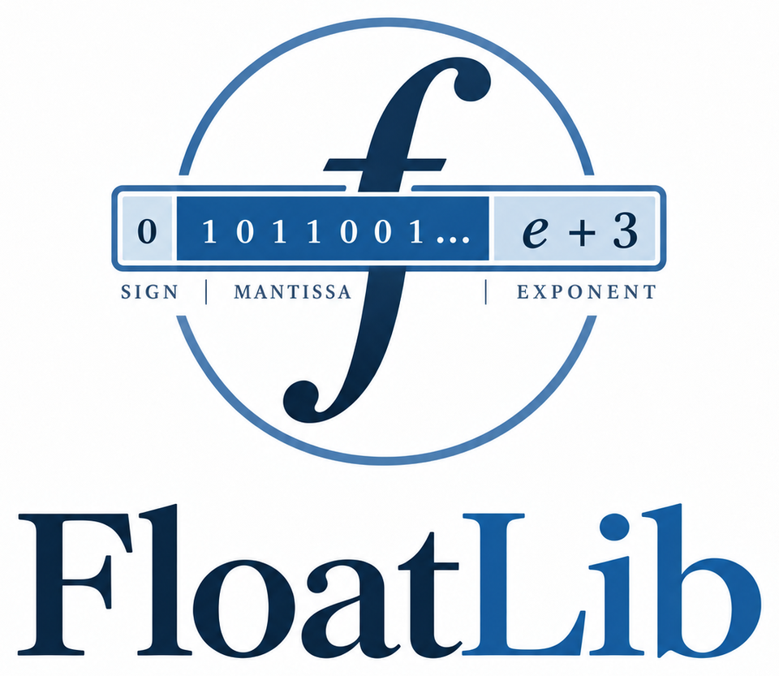

<h1 align="center">

Verified Floating-Point Arithmetic in Lean
</h1>

FloatLib is a Lean 4 library for arbitrary-precision floating-point arithmetic and verified
numerical computation. It brings together executable arithmetic, formal numerical specifications,
refinement proofs, rounding theory, and proof automation for numerical analysis.

The library supports IEEE 754 binary and decimal formats, posits with exact quire accumulation, and
low-precision formats for machine learning. A common numerical interface and shared integer kernels
allow new formats and rounding rules to reuse existing implementations and proofs. The
specifications account for signed zeros, infinities, NaNs, and exception flags.

One of our main goals is to make verified numerical computation practical, both for executing
numerical algorithms and for checking numerical certificates directly in Lean's kernel. The library
includes `float_decide` for proof by computation, `roundoff` for floating-point error analysis, and
`interval` for certified numerical bounds.

[Documentation](https://lean-dojo.github.io/FloatLib/) · [Installation and
examples](https://lean-dojo.github.io/FloatLib/#/chapter/using-the-library) · [Theorem
index](FloatLib/Floats/THEOREMS.md) ·
[Benchmarks](https://lean-dojo.github.io/FloatLib/#/chapter/performance) · [Trust
assumptions](TRUST.md)

## Installation

From a checkout of this repository, fetch the Mathlib cache and build FloatLib:

```bash
lake exe cache get
lake build
```

Use the Lean version in [lean-toolchain](lean-toolchain). Dependency versions are pinned in
[lake-manifest.json](lake-manifest.json).

In your own Lake project, add FloatLib with `require`:

```lean
require floatlib from git
  "https://github.com/lean-dojo/FloatLib.git" @ "main"
```

Then run `lake update`, `lake exe cache get` and `lake build`. For further details, see the [project
setup
instructions](https://lean-dojo.github.io/FloatLib/#/chapter/using-the-library/how-to-set-up-a-project).

## An Example

The `float_decide` tactic proves closed, decidable goals by computation. It rewrites supported
floating-point operations using proved equations and evaluates the resulting expression with `decide
+kernel`, without relying on compiled execution for the proof.

```lean
import FloatLib

open FloatLib.Floats

#eval (1.5 : Binary32) + 2.25  -- 3.75
example : (1.5 : Binary32) + 2.25 = 3.75 := by float_decide
```

On a 1,000-term binary64 dot product, Lean's kernel checked the loop in 152 ms, compared with 730 ms
for Flocq under Rocq's `vm_compute`. On a separate integer square-root proof, FloatLib's exact
arithmetic took 11.5 ms with `decide +kernel` and 13.1 ms with `native_decide`. See the
[floating-point
timings](benchmarks/results/kernel/README.md#three-theorems-about-loops-of-1000-steps) and [exact
arithmetic timings](benchmarks/results/exact/native.md).

## What you can work with

The following is an overview of the main components. The [documentation](https://lean-dojo.github.io/FloatLib/) contains the full API coverage, mathematical background, and worked examples.

- **Proof by computation.** `float_decide` proves closed, decidable statements by rewriting
  supported operations to equivalent computations on their encodings. For example, the kernel can
  check a binary addition together with its rounding flags. Kernel rewrite rules cover nearly all
  IEEE 754-2019 operations on binary and decimal formats, including character-sequence conversions,
  augmented operations, and reductions. They also cover posit arithmetic, the P3109 operations and
  the OCP MX and NVFP4 quantizers. The certified functions of clause 9.2 are the main exception.
  `lane_decide` proves equalities of supported natural-number expressions over all pairs of small
  finite indices. It evaluates each side once with all input pairs packed together. The
  [guide](https://lean-dojo.github.io/FloatLib/#/chapter/proof-by-computation) gives examples and
  lists the operations with kernel rules for each format.
- **Backend registration.** The `@[kernel_optimize]` attribute registers proved equations for
  `float_decide` and `interval`, while `@[compiler_optimize]` registers certified implementations
  with the compiled planner. Both require a complete proof using only Lean's three standard axioms.
  `#kernel_rules` and `#compiler_backends` list the available implementations.
- **Exact arithmetic in the kernel.** `Numerics.Kernel` provides integers, rationals, dyadics and
  real and complex enclosures for checking numerical certificates. Its arithmetic operations have
  proofs relating them to ordinary arithmetic. The packed-row operations can check a dot product or
  a polynomial product by multiplying two natural numbers.

- **Native 16-bit carriers.** `Floats.Native.Half` and `BFloat16` store binary16 and bfloat16 words.
  Narrowing from any format, widening to binary32, and NaN normalization are proved to agree with
  the reference cast. Arithmetic is performed in host binary32 and rounded to the destination
  format; this path is tested against the software models rather than formally verified.
- **IEEE binary and decimal.** Binary arithmetic handles subnormals, signed zeros, infinities, NaNs,
  rounding modes and status flags. Decimal32, decimal64 and decimal128 come in both the BID and DPD
  encodings, with arithmetic, conversions and rounding proofs. Operations use the terminology of
  IEEE 754-2019, including `roundToIntegralTiesToEven`, `compareQuietLess` or `augmentedAddition`,
  and [the operation
  table](https://lean-dojo.github.io/FloatLib/#/chapter/ieee-binary-formats/where-is-each-operation-of-ieee-754-2019)
  maps the required operations of clause 5 and the recommended families of clause 9 to their binary
  and decimal implementations. It lists the available theorems and identifies gaps by format. The
  coverage includes augmented operations, extrema by magnitude, NaN payload operations, `sumAbs`,
  `sumSquare`, scaled products, and formatOf operations, in which the operands and result may use
  three different formats and the exact result is rounded once.
- **Posits and quires.** `ExecFloat.Posit (bits := n)` defines a posit format of width `n`. Its
  associated quire, `ExecFloat.Posit.Quire (bits := n)`, accumulates products exactly within its
  capacity, with a single rounding at the end. The API follows the terminology of the 2022 posit
  standard. The standard fixes two exponent bits. The underlying operations on encodings and their
  proofs are parameterized by the number of exponent bits, allowing kernel computation with other
  posit formats, including SoftPosit's 8-bit and 16-bit types.
- **Small and custom formats.** FP8, FP6, FP4, fixed point, logarithmic and codebook representations
  all share the same numerical interfaces. Block-scaled formats share a definition parameterized by
  element format, scale format, block shape, and scale-selection rule, with OCP MX, NVFP4, and Four
  Over Six as instances. The executable OCP MX and NVFP4 quantizers are proved to agree with their
  real-valued specifications. `Block.nvfp4Working` models the binary32 computation of a deployed
  NVFP4 quantizer in torchao's order of operations. Its theorems for the stored scale and elements
  require no overflow hypothesis. It is one instance of a quantizer for any block and any binary
  working format. OCP's two FP8 formats are `E4M3` and `E5M2`, as OFP8 spells them, with saturating
  and non-saturating conversion. MX dot products support exact intermediate computations or a
  specified finite accumulator, with an error bound for the latter. Fixed point follows Embedded C
  (ISO/IEC TR 18037), as one family over layout, rounding and overflow policy. The [P3109
  chapter](https://lean-dojo.github.io/FloatLib/#/chapter/low-precision-formats-for-machine-learning/what-is-ieee-p3109),
  describes the working group's format rules and the report underlying the implementation.
- **Classical rounding results.** Correct rounding, half-ulp error bounds and Sterbenz's
  exact-subtraction lemma relate the real-valued theory to executable arithmetic. Mixed-precision
  bounds cover casts, products and accumulator updates, under their stated finiteness assumptions.
- **The `roundoff` tactic.** With the `Tactic.Roundoff` import, the tactic proves error bounds for
  configured computations, loops over lists, arrays, vectors and matrices included. `MixedError`
  propagates relative and absolute error bounds through binary operations, casts and sums. The
  `roundoff theorem` and `roundoff mixed theorem` commands generate a theorem and its proof, with
  the required range conditions as hypotheses. `roundoff (backward := true) theorem` generates a
  backward-error theorem instead: the computed value is within an absolute underflow allowance of
  the exact computation on inputs `x * (1 + δ)`, with a bound on each `δ` and the allowance read off
  the code. The equality is exact where no operation can underflow. `roundoff closed theorem`
  generates the forward bound in closed form. The commands analyze individual `match` branches and
  interpret programs using Lean's `Float` and `Float32` through their corresponding `Binary64` and
  `Binary32` models. Subtractions proved exact using Sterbenz's lemma contribute no rounding error.
  `#roundoff_check` evaluates a generated bound at specified inputs and reports when the bound is
  insufficient to determine the sign of the result. See the [roundoff
  guide](https://lean-dojo.github.io/FloatLib/#/chapter/proving-numerical-bounds/how-to-get-an-error-bound-for-floating-point-code).
- **Stochastic rounding.** A single stochastic rounding step is proved unbiased, with variance
  bounded by one quarter of the squared spacing. The executable rounder, which compares `entropy %
  denominator` with a remainder, is proved to follow that law when the denominator divides the
  entropy range. `roundoff stochastic theorem` then generates the mean, second moment, tail bound
  and confidence radius of a sum, a dot product or an affine map that draws fresh entropy at every
  rounding. See [the
  guide](https://lean-dojo.github.io/FloatLib/#/chapter/proving-numerical-bounds/fresh-stochastic-rounding).
- **Interval and affine arithmetic.** The interval evaluator supports exact rational endpoints
  and configurable outward rounding, with containment theorems for its operations. The
  [`interval` tactic](https://lean-dojo.github.io/FloatLib/#/chapter/proving-numerical-bounds)
  proves real inequalities and infeasibility of systems of constraints by certified evaluation
  and subdivision. It also supports unbounded intervals, derivative-based arguments at boundary
  points, and existential goals through witness construction. Affine arithmetic accounts for
  dependencies between repeated variables; for example, it bounds `x * (1 - x)` on `[0, 1]`
  by `[0, 1/4]` rather than `[0, 1]`. Affine quantization has a real-valued specification
  parameterized by the rounding rule and a correctness proof for the executable nearest-even
  implementation.
- **Bounds from coefficients.** The same `interval` tactic proves bounds over a whole domain from
  coefficients: trigonometric polynomials with cosine and sine terms on the circle, power
  polynomials on intervals with rational endpoints, Chebyshev series after affine rescaling, and
  norms of polynomials on the unit circle of `ℂ`, with rational coefficients or the exact values of
  float data. Lean's kernel checks sum-of-squares certificates using packed integer rows. Wiener
  algebra defect theorems also bound the errors of approximations to inverse and inverse square root
  functions. See [the coefficient
  guide](https://lean-dojo.github.io/FloatLib/#/chapter/proving-numerical-bounds/how-to-bound-a-polynomial-on-the-whole-circle).
- **Repeatedly rounded sums.** A reduction tree fixes the order of the additions, and its error
  bounds account for rounding at every node, absolute-error terms near underflow included. The bound
  grows with the depth of the tree, `((1 + u) ^ depth - 1)` times the sum of the magnitudes, so a
  balanced reduction of `n` terms has depth `⌈log₂ n⌉`, compared with `n - 1` for a sequential
  reduction starting from the first term. Exact accumulators provide an alternative with a single
  final rounding. IEEE 754-2019 permits reductions with different association orders and wider
  accumulator formats. Accordingly, `sumInOrder` and `sumAlong` take the accumulator format and the
  order as arguments, with an error bound for every order. For a left-to-right, nearest-even sum of
  `n` terms in an IEEE format, starting at zero and ending with a finite result, the error is at
  most `(n - 1) u` times the sum of their magnitudes (Rump). For a dot product the factor is `n u`
  on the sum of the absolute exact products, provided each exact product is zero or in the normal
  range (Jeannerod and Rump).
- **Elementary functions and complex numbers.** Posit elementary functions are proved to return the
  correctly rounded real result. For IEEE binary formats, `ExecFloat.Binary.Certified.exp`, `log`,
  `pow`, `expm1` and `logp1` return a correctly rounded finite result when rational enclosure
  refinement succeeds, and return diagnostic information otherwise. The
  `Configured.CorrectlyRounded` module provides total functions
  `ExecFloat.Binary.CorrectlyRounded.exp`, `log`, `expm1`, `logp1` and `expMul`, correctly rounded
  on IEEE formats with no premise on the search budget, plus the other functions that IEEE 754-2019
  recommends (`exp2`, `log10`, `sinPi`, `atan2`, `pow`, `powr`, `compound` and the rest). For finite
  inputs in the theorem's domain, each result is the real function rounded once in any of the five
  IEEE rounding directions. In particular, upward and downward rounding return the closest
  representable values on the corresponding side. On configured values that theorem is stated for
  the functions of one argument. `atan2`, `atan2Pi`, `pow`, `powr` and `compound` are the
  descriptor-model functions through the storage codec, and their theorems are stated on the
  descriptor model. The descriptor model has every function of clause 9.2 in this form, `exp`,
  `log`, `rSqrt`, `hypot`, `rootn` and `pown` included, with exception flags, and the theorem also
  holds for the eight-bit formats OCP E5M2 and E4M3. Decimal formats have the same functions with
  flags in five directions, and P3109 formats in every rounding and saturation mode.
  `Configured.Transcendentals` also provides deterministic approximation kernels for binary
  functions. General error bounds for these kernels remain unproved, although their results agree
  with MPFR on every case in the elementary-function test tiers. Sine and cosine can return an
  invalid result if they run out of argument-reduction budget. For IEEE-style descriptors, that
  import's `pow` of a positive base is correctly rounded whenever its enclosure search settles, and
  its `pi` is correctly rounded. `ExecComplex` implements arithmetic on pairs of binary components,
  with theorems accounting for scalar rounding and error bounds for complex operations: the product
  is within `√5 u |xy|` of the exact one (Brent, Percival and Zimmermann), within `2u |xy|` with
  fused multiply-adds, both up to an underflow term, and the ratio division within `√2 γ₇ |x/y|`
  when no intermediate underflows. Under `Complex.Elementary`, the complex `exp`, `log`, `sqrt`,
  `rsqrt`, `expm1`, `log1p`, the six trigonometric and hyperbolic functions and their inverses are
  correctly rounded in every rounding direction at every finite argument, with the special values of
  C23 Annex G. For a finite nonzero base and a finite exponent in an IEEE format, `pow_eq` proves
  correct rounding when `powCertified` returns `true`. `powChecked` returns both the value and
  certification flag. See the [examples](FloatLib/Examples/Transcendentals.lean) and the [complex
  section](https://lean-dojo.github.io/FloatLib/#/chapter/ieee-binary-formats/how-to-work-with-complex-numbers).

Our [theorem index](FloatLib/Floats/THEOREMS.md) collects the major theorems.
[formalization.yaml](formalization.yaml) records the mathematical sources, scope, key results, and
use of AI in development. We spent several months designing the library and developing its
foundations, with assistance from Codex in completing some proofs and optimizing the arithmetic
backends.

## Limitations

FloatLib implements the operations listed in the IEEE 754 working group's notes for binary and
decimal formats. [The operation
table](https://lean-dojo.github.io/FloatLib/#/chapter/ieee-binary-formats/where-is-each-operation-of-ieee-754-2019)
lists the corresponding theorems. Full IEEE 754-2019 conformance has not been proved: the predicate
`is754version2019` remains `false`. The remaining limitations include:

- **The special cases of the functions of clause 9.2.** On binary formats the value in every
  rounding direction, its sign and the overflow result are proved at finite operands in the domain.
  The five flags are also covered for each function (including `cbrt` as `rootn` of degree three):
  `inexact` for a finite result, `invalid` and `divideByZero` clear, and where the real value is not
  zero `overflow` by the rule of clause 7.4 and `underflow` by the rule of clause 7.5 with tininess
  detected after rounding. Tininess is stated by the boundary of each direction, as for the
  arithmetic operations, and is not derived from a rounding function with an unbounded exponent
  range. Where the real value is zero the result is proved to be a zero, and `overflow` and
  `underflow` have no theorem there. The results at infinities, NaNs and outside the domains are
  definitions without a theorem. For decimal formats the theorem covers the five flags at finite
  operands in the domain, and the same special cases are definitions.
- **The formatOf operations across formats.** In one format they are proved to be the operations of
  that format for every operand, with flags and ternary value. Across formats the value is proved
  for finite operands: in every direction for addition, subtraction, multiplication and
  fusedMultiplyAdd when the exact result is in the range of the destination, and to nearest-even for
  division. The quotient in the other directions, the flags and the special cases across formats are
  compared with the rules of the standard on every pair of encodings of a six-bit format. The
  formatOf square root is proved correctly rounded in every direction, and its flags other than
  `inexact` are compared the same way.
- **Configured values.** `ExecFloat.Binary.CorrectlyRounded` has the 30 recommended functions and
  `pow`. The forms with flags of `exp`, `expm1`, `log`, `logp1`, `rSqrt`, `hypot`, `rootn` and
  `pown` in every direction are functions of the descriptor model (`Model.Transcendentals.Directed`,
  `Model.Algebraic.Directed`).
- **Alternate exception handling.** FloatLib returns the exception flags as data. The attributes of
  clause 8 for alternate exception handling are not implemented.
- **P3109 extensions.** `Exp10`, `Log10`, `Cbrt`, `Rootn`, `Pown`, `Pow`, `Powr`, `Compound` and
  related P3109 operations are outside the interim report. They follow its conventions: one zero,
  one NaN, and NaN at a pole at zero.

## Performance and validation

Performance is a central design objective of FloatLib. We want arithmetic implementations that
remain formally connected to their specifications while being competitive with established numerical
libraries such as MPFR. For example, binary128 values are stored in two machine words, with
dedicated kernels that avoid splitting and joining GMP integers. The
[planner](https://lean-dojo.github.io/FloatLib/#/chapter/performance) selects among lookup tables,
word kernels, and wider limb algorithms. Each certified backend requires a proof of agreement with
the common specification. Backend selection is configurable, and the unchecked host-FPU path is
available only through explicit calls.

For a single operation, rewriting brought kernel checking time down to 72 to 141 microseconds on
normal binary64 operands. At 4,096 bits, all six operations took at most 283 microseconds on normal
operands. The [chapter on kernel
computation](https://lean-dojo.github.io/FloatLib/#/chapter/proof-by-computation) gives the timings
by operation and compares proof checkers.

On ordinary binary64 calls, FloatLib's proved addition, subtraction and multiplication beat MPFR at
the same precision, multiplication by about 2.4 times. Our
[benchmarks](https://lean-dojo.github.io/FloatLib/#/chapter/performance) compare scalar operations
from 2 to 4,096 bits, and report the relative performance of both implementations. Lean checks the
proofs before execution and erases them during compilation, so the compiled arithmetic does not
check proofs at runtime. An independent replay of compiled declarations in Lean's kernel can be
enabled with `FLOATLIB_RUN_INDEPENDENT_CHECKER=1 bash tests/verify.sh`.

Proofs establish agreement between implementations and specifications; they do not by themselves
establish that the specifications capture the intended external standards. We therefore validate the
library against independent implementations. All **127,741,704** Berkeley TestFloat level-1 vectors
in our 210 campaigns matched on values and exception flags under the reference's NaN comparison
rules. The campaigns cover binary16, binary32, binary64 and binary128, plus conversions involving
bfloat16. Separate comparisons cover MPFR, decimal arithmetic, small-format tables and posits. Our
comparisons with MPFX found four bugs in that library, which we've reported upstream. SoftPosit
disagrees with us on a small set of boundary cases, and [the
analysis](https://lean-dojo.github.io/FloatLib/#/chapter/external-validation/why-did-softposit-disagree-with-floatlib)
documents the numerical calculations underlying these discrepancies.

The [testing guide](tests/README.md) and [benchmark guide](benchmarks/docs/Comparison.md) provide
instructions for reproducing the external comparisons and performance measurements.
[TRUST.md](TRUST.md) documents the trust assumptions, including those associated with compiled
execution.

## Source files

The library is organized into four main components:

| Directory | Description |
| --- | --- |
| [`FloatLib/Numerics`](FloatLib/Numerics) | Representation-independent specifications, exact arithmetic, contracts, enclosures, packed rows for kernel certificates, and coefficient bounds |
| [`FloatLib/Kernels`](FloatLib/Kernels) | Shared word and limb algorithms with refinement proofs |
| [`FloatLib/Floats`](FloatLib/Floats) | Concrete formats, real-valued rounding theory, executable operations, and their proofs |
| [`FloatLib/Tactic`](FloatLib/Tactic) | Tactics, commands and attributes: `roundoff`, `interval`, `float_decide`, the backend tags, `#float_info` |

Tests and benchmarks use separate Lake workspaces and are not imported by the library. The
[website](site/) contains the documentation, checked Lean examples, references, and dependency
graphs.

## Contributing

We welcome contributions to FloatLib, including new numerical formats, faster arithmetic kernels,
mathematical results, proofs, and applications. If you are working on something related or have
ideas for the library, feel free to [reach out](https://github.com/lean-dojo/FloatLib/issues) :)

FloatLib builds on Mathlib and follows its proof style and naming conventions; see the [contributing
guide](CONTRIBUTING.md) for development and testing conventions.

For a local check of the library and website:

```bash
bash tests/verify.sh     # build the library and run its checks
bash site/build.sh       # build the guide and check its examples
```

## License and credits

Thanks to the Lean, Mathlib, and Flocq communities, and to the authors of the libraries used in our
comparisons.

FloatLib is [MIT licensed](LICENSE). See [third-party licenses](third_party/README.md) for external
code, data, and fonts.

## Citation

If you use FloatLib in your research, please cite our [paper](https://arxiv.org/abs/2609.19352):

```bibtex
@misc{george2026floatlib,
  title         = {{FloatLib}: Verified Floating-Point Arithmetic in {Lean}},
  author        = {George, Robert Joseph and Adkisson, Will and Anandkumar, Anima},
  year          = {2026},
  eprint        = {2609.19352},
  archivePrefix = {arXiv},
  primaryClass  = {cs.LO},
  url           = {https://arxiv.org/abs/2609.19352}
}
```
