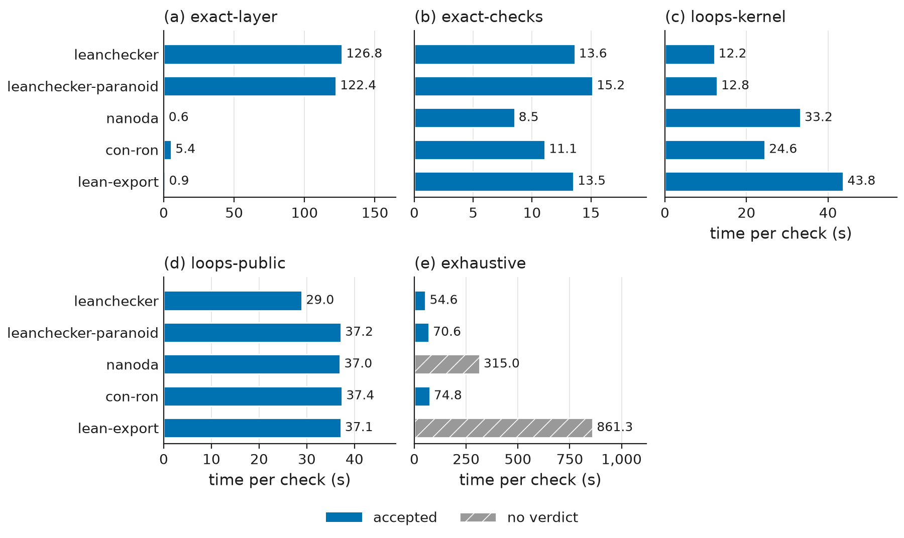
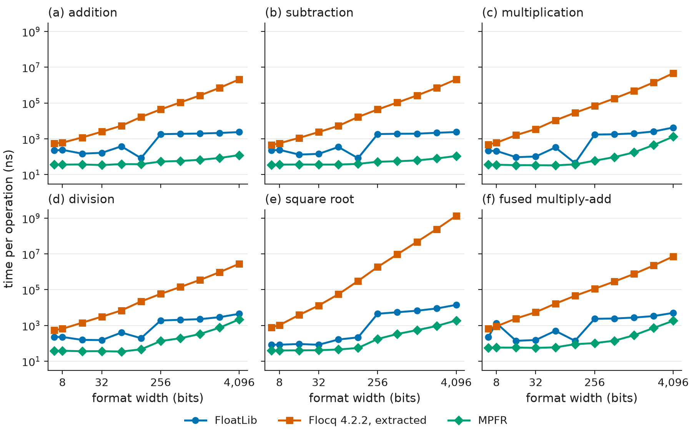

# Figures

Written by `benchmarks/plots/figures.py draw`; do not edit by hand. Every figure is in `figures/` as `NAME.png` (for the site, 9 inches wide at 200 dpi), `NAME.pdf` (vector) and `NAME.csv` (the numbers that are drawn, one row per mark).

The figures follow the figure rules of the library: an image holds only the plot, its axes with units, a legend with short series names and panel letters. Everything else is in the entry of the figure below: its **caption** (what the figure shows, what was measured and in which unit, the scales, the machine and the toolchain), which is the title of the Markdown image and is what the guide prints under the figure; its **alt text**, which describes the image; and its **notes** (how it was measured, where a recorded number comes from, which numbers come from Lean and which from scripts).

| figure | name | shows |
| --- | --- | --- |
| Figure 1 | `kernel-binary` | Kernel time of one binary operation of FloatLib from 8 to 4,096 bits, as written and on the kernel path. |
| Figure 2 | `kernel-operands` | Kernel time of one operation of FloatLib by operand class: normal operands, subnormal operands and special values. |
| Figure 3 | `kernel-ieee2019` | Kernel time of the operations of IEEE 754-2019 on binary formats, by family and format width, as written and with FloatLib's kernel rules. |
| Figure 4 | `kernel-extras` | Kernel time of the terms beyond the six operations (status flags, comparisons, conversions, casts and literals), as written and with FloatLib's kernel rules. |
| Figure 5 | `kernel-vs-coq` | Time of one floating-point operation inside the proof checker: FloatLib in Lean's kernel against Flocq 4.2.2 in Coq 8.20.1 under vm_compute and under lazy. |
| Figure 6 | `kernel-loops` | Time to check a theorem about a loop of 1,000 floating-point operations: FloatLib by decide +kernel and by float_decide, and Flocq 4.2.2 in Coq 8.20.1. |
| Figure 7 | `kernel-families` | Kernel time of one operation outside the binary interchange formats, as written and with the kernel rules of FloatLib: fixed point, logarithmic, P3109, posits and the quire, OCP MX elements and blocks, decimal, OCP FP8 and NVFP4 blocks. |
| Figure 8 | `kernel-all-pairs` | Kernel time to decide one statement about all 65,536 pairs of encodings, by the loop of float_decide and by lane_decide in FloatLib. |
| Figure 9 | `kernel-exact-operations` | Kernel time of one exact operation (integers, fractions, bit operations, roots, modular powers, dyadics, balls and lists), written with the types of core Lean and Mathlib and on the kernel layer of FloatLib, with Coq 8.20.1 where the operation is the same. |
| Figure 10 | `kernel-exact-library` | Time of FloatLib's own exact arithmetic and of the interval tactic. |
| Figure 11 | `kernel-exact-native` | Time to prove one closed statement by decide +kernel on the kernel layer of FloatLib and by native_decide. |
| Figure 12 | `kernel-checkers` | Time the independent checkers of Lean proofs take on the kernel proofs of FloatLib, by family of proofs. |
| Figure 13 | `interval-corpora` | Goals closed on four test corpora (169 goals) by FloatLib's interval tactic, by Mathlib's dyadic_interval and by SymLean's cega. |
| Figure 14 | `correctly-rounded` | Compiled time of one call of each correctly rounded function of FloatLib by format width: 34 real functions and 18 complex functions. |
| Figure 15 | `compiled-precision` | Time per operation against format width, both on logarithmic scales. |
| Figure 16 | `suites-fpbench` | FPBench: what FloatLib's roundoff tactic proves, and its proved bounds against FPTaylor and Gappa. |
| Figure 17 | `suites-inequalities` | MetiTarski and Flyspeck inequalities given to FloatLib's interval tactic, alone and with the constraint engine. |
| Figure 18 | `suites-hard-cases` | Hard-to-round inputs of exp, expm1, log and log1p: the results of FloatLib against MPFR, CORE-MATH and GNU MPC, and the time per call. |
| Figure 19 | `suites-testfloat` | Berkeley TestFloat, level 1: the campaigns FloatLib matches and the vectors they check, by format. |

## How the numbers were made

```bash
python3 benchmarks/plots/figures.py time RAW     # measure this checkout, write the results, draw
python3 benchmarks/plots/figures.py draw         # draw again from the result files
```

`RAW` is a directory outside the checkout for the logs. The library has to be built (`FLOATLIB_BUILD_DIR`, or `.lake/build`); the timing mode links the benchmark executables it starts and builds nothing else. It runs the runners under `benchmarks/kernel/`, `benchmarks/suite/`, `benchmarks/exact/` and `benchmarks/scripts/`: the kernel sections one at a time, because another job on the machine disturbs their cells, and then the others at most eight at a time. On Linux with core scheduling a measuring process has its cores to itself, the rows of 1,024 and 4,096 bits of the IEEE table excepted, which run eight at a time: a job on the second hardware thread of a core makes a measurement on the first 1.5 to 2 times slower. Those runners print every time (`Lean.Kernel.whnf`, Lean's profiler, `IO.monoNanosNow`, `/usr/bin/time`). Python starts them, copies their tables and draws.

The timing mode used Lean v4.36.0 on Intel Xeon Platinum 8275CL @ 3.00GHz, 96 threads, shared with other jobs, in 4 runs with 24 threads in all. Run 1, started 2026-11-20T07:21Z, 8 sections at a time, 96 minutes of wall time: `ieee2019-wide`. Run 2, started 2026-11-20T10:37Z, 5 sections at a time, 45 minutes of wall time: `kernel-binary`, `families`, `compiled`, `compiled-comparison`, `matched`, `kernel-public`, `kernel-spec`, `kernel-public-64`, `kernel-spec-64`, `kernel-64`, `ieee2019`, `ieee2019-compiled`, `extras`, `blocks`, `exact-compiled`. Run 3, started 2026-11-20T11:38Z, one section at a time, 6 minutes of wall time: `functions`. Run 4, started 2026-11-20T13:55Z, one section at a time, 5 minutes of wall time: `exhaustive`, `loops`, `exact`, `exact-native`. A section that is measured again replaces its earlier files.

| section | exit | seconds | rows | Lean errors in its logs |
| --- | ---: | ---: | ---: | ---: |
| `kernel-binary` | 0 | 38 | 234 | 0 |
| `families` | 0 | 22 | 33 | 0 |
| `exhaustive` | 0 | 64 | 9 | 0 |
| `compiled` | 0 | 574 | 246 | 0 |
| `compiled-comparison` | 0 | 1367 | 288 | 0 |
| `matched` | 0 | 19 | 35 | 0 |
| `kernel-public` | 0 | 30 | 90 | 0 |
| `kernel-spec` | 0 | 9 | 36 | 0 |
| `kernel-public-64` | 0 | 86 | 90 | 0 |
| `kernel-spec-64` | 0 | 14 | 36 | 0 |
| `kernel-64` | 0 | 27 | 126 | 0 |
| `ieee2019` | 0 | 604 | 1212 | 0 |
| `ieee2019-wide` | 0 | 5045 | 282 | 0 |
| `ieee2019-compiled` | 0 | 185 | 1217 | 0 |
| `functions` | 0 | 323 | 310 | 0 |
| `extras` | 0 | 100 | 38 | 0 |
| `loops` | 0 | 98 | 6 | 0 |
| `blocks` | 0 | 14 | 12 | 0 |
| `exact` | 0 | 143 | 1359 | 0 |
| `exact-native` | 0 | 4 | 13 | 0 |
| `exact-compiled` | 0 | 56 | 74 | 0 |

Not measured by the timing mode, and where it comes from:

- **Coq.** Coq 8.20.1 with Flocq 4.2.2, recorded 2026-11-15 in the image `leanfloat-flocq-bench:4.2.2`, one container at a time with 8 GB and two CPUs. These times do not depend on FloatLib's commit.
- **Counts.** Proofs accepted, bounds, vectors matched and goals closed are correctness results from the recorded suite runs.

The recorded files are in `figures/recorded/`, and `figures/recorded/README.md` says where each came from.

## Kernel features and where their numbers are

| feature | figure, and the table behind it |
| --- | --- |
| `float_decide` and the binary kernel path (`KernelPath.Value.*`) | Figure 1 (`kernel-binary`), Figure 2 (`kernel-operands`), Figure 4 (`kernel-extras`), Figure 6 (`kernel-loops`), Figure 5 (`kernel-vs-coq`); `kernel/README.md` |
| the rules tagged `@[kernel_optimize]`, family by family | Figure 3 (`kernel-ieee2019`), Figure 7 (`kernel-families`), Figure 4 (`kernel-extras`); `ieee2019/README.md`, `backends/README.md` |
| `#kernel_cost` | the command that measures Figure 7 (`kernel-families`) and the Lean side of Figure 5 (`kernel-vs-coq`) |
| `lane_decide`, lane tables and packed rows | Figure 8 (`kernel-all-pairs`) (its `add-table` row is the kernel check of one packed table), Figure 11 (`kernel-exact-native`) (a packed row product) |
| `Z`, `Signed` | Figure 9 (`kernel-exact-operations`); `exact/operations.md`, section `int` |
| `Q`, `Frac` | Figure 9 (`kernel-exact-operations`); section `rat` |
| `Bits` (`size`, `testBit`, `popCount`), `Root` (`isqrt`, `isRoot`) | Figure 9 (`kernel-exact-operations`); section `nat` |
| `Dyad`, `Ball` | Figure 9 (`kernel-exact-operations`); sections `dyad` and `ball` |
| `CBall`, `CFix` | Figure 9 (`kernel-exact-operations`) (complex ball product); section `complex` |
| `Seq`, and the cover check of `Multiplicative` | Figure 9 (`kernel-exact-operations`) (lists of 256); section `list` |
| `Bisection`, `Strict` | `exact/operations.md`, section `search` |
| `Mod` (`powMod`, `invMod`) | Figure 9 (`kernel-exact-operations`), Figure 11 (`kernel-exact-native`); section `mod` |
| FloatLib's own exact layer, and `interval` on it | Figure 10 (`kernel-exact-library`); `exact/baseline.md`, `exact/tactic.md` |
| independent checkers of the kernel proofs | Figure 12 (`kernel-checkers`) |
| `kernel_twin`, `#kernel_eval`, `#kernel_rules`, `#compiler_backends`, `@[compiler_optimize]` | no runner times them: they declare or list rules and have no time of their own here |

## Figure 1: kernel-binary

.")

**Figure 1.** Kernel time of one binary operation of FloatLib from 8 to 4,096 bits, as written and on the kernel path. A point is the time Lean's kernel takes for one operation on normal operands, rounded to nearest even, as the median over the formats of that width; as written is the public operation, and the kernel path is the term that float_decide checks. Both axes are logarithmic, lower is faster, and the public operations were not measured above 128 bits. Measured with Lean v4.36.0 (Intel Xeon Platinum 8275CL @ 3.00GHz, 96 threads, shared with other jobs, 2026-11-20).

Alt text: Six panels, one per arithmetic operation: kernel time against format width, with open markers for the public operation as written up to 128 bits and a line for the kernel path up to 4,096 bits.

Notes: Eight operand triples per cell, the fastest of three runs (`benchmarks/kernel/run.sh`). The formats of a width are E4M3 and E5M2 at 8 bits, binary16 and bfloat16 at 16, the IEEE layouts above, and two custom layouts of 24 and 80 bits. The public operation is `+`, `-`, `*`, `/`, `sqrt`, `fma` as written (for the two one-byte formats the reference operation, because the kernel cannot evaluate their table lookups). Over the 30 cells that have both, the operation as written costs 24 to 1,281 times (geometric mean 50) the kernel path. From Lean: every time (`Lean.Kernel.whnf`, printed by Lean). From scripts: the medians over formats, the ratios and the drawing.

Files: `figures/kernel-binary.png`, `figures/kernel-binary.pdf`, `figures/kernel-binary.csv` (96 rows).

CSV columns:

- `operation`: add, sub, mul, div, sqrt or fma
- `series`: `written` (the public operation) or `now` (the kernel path)
- `bits`: format width
- `microseconds`: kernel time of one operation, median over the formats of that width

Inputs: `benchmarks/results/backends/kernel-binary.csv`, `benchmarks/results/kernel/as-written.csv`.

Measured again by: `python3 benchmarks/plots/figures.py time RAW --only kernel-binary kernel-public kernel-spec`.

## Figure 2: kernel-operands

.")

**Figure 2.** Kernel time of one operation of FloatLib by operand class: normal operands, subnormal operands and special values. A point is the time Lean's kernel takes for one operation on the kernel path, as the median over the formats of that width. The width axis is logarithmic, and lower is faster. Measured with Lean v4.36.0 (Intel Xeon Platinum 8275CL @ 3.00GHz, 96 threads, shared with other jobs, 2026-11-20).

Alt text: Six panels of lines, one per arithmetic operation: kernel time against format width for normal operands, subnormal operands and special values, all on the kernel path.

Notes: Special values are zeros, the smallest subnormal, one, the largest finite value, infinities and NaNs. Eight operand triples per cell, the fastest of three runs. From Lean: every time (`Lean.Kernel.whnf`). From scripts: the medians and the drawing.

Files: `figures/kernel-operands.png`, `figures/kernel-operands.pdf`, `figures/kernel-operands.csv` (198 rows).

CSV columns:

- `operation`
- `operands`: normal, subnormal or special
- `bits`
- `microseconds`: kernel time of one operation, median over the formats of that width

Inputs: `benchmarks/results/backends/kernel-binary.csv`.

Measured again by: `python3 benchmarks/plots/figures.py time RAW --only kernel-binary`.

## Figure 3: kernel-ieee2019

.")

**Figure 3.** Kernel time of the operations of IEEE 754-2019 on binary formats, by family and format width, as written and with FloatLib's kernel rules. A line is the median over the operations of a family of the time Lean's kernel takes for one evaluation, at the widths at which every one of them has a time, and the band is their range; where the two lines coincide the family has no kernel rule. Both axes are logarithmic, and lower is faster. Measured with Lean v4.36.0 (Intel Xeon Platinum 8275CL @ 3.00GHz, 96 threads, shared with other jobs, 2026-11-20).

Alt text: 16 small panels of lines, one per family of operations of the standard: kernel time against format width from 8 to 4,096 bits, with a dashed line and band for the operation as written and a solid line and band for the same operation with the kernel rules.

Notes: Each operation of clauses 5 and 9 is measured under its name in the standard, as written (the reference definition) and as `float_decide` rewrites it with the rules tagged `@[kernel_optimize]` (`benchmarks/kernel/ieee2019.sh 4 3`: four operand triples per cell, the fastest of three); at 1,024 and 4,096 bits a row has 600 seconds and a certified function of clause 9.2 5,400. A line ends where an operation of its family has no time, because it takes longer than a row allows or its cell came out at zero or below. The panel neighbours holds `nextUp`, `nextDown` and `remainder`, and the panel functions the recommended functions of clause 9.2. Operations per family: arithmetic 6, comparisons 22, roundToIntegral 6, convertToInteger 10, classification 11, minimum, maximum 8, sign operations 4, total order 2, scaleB, logB 2, neighbours 3, formatOf 5, augmented 3, NaN payload 3, reductions 12, conversions 6, functions 38. A cell is the difference of two folds, and the fold that is subtracted reads and stores its operand; for an operation that reads less of it (`radix`, `isCanonical` as written) the difference is zero or below, and such a cell is left out. The comparisons, the conversions to integers, the casts (`formatOf`, `convertFormat`) and the additions of the 2019 revision are all here; the decimal formats are in `ieee2019/README.md` and in `kernel-families`. From Lean: every time (`Lean.Kernel.whnf`). From scripts: the grouping into families, medians and ranges.

Files: `figures/kernel-ieee2019.png`, `figures/kernel-ieee2019.pdf`, `figures/kernel-ieee2019.csv` (243 rows).

CSV columns:

- `family`: group of operations (its members are in `ieee2019/kernel.csv`)
- `path`: `as written` or `with rules`
- `bits`: format width
- `median_us`: median over the family, microseconds
- `min_us`
- `max_us`
- `operations`: how many operations of the family have a value at that width

Inputs: `benchmarks/results/ieee2019/kernel.csv`.

Measured again by: `python3 benchmarks/plots/figures.py time RAW --only ieee2019 ieee2019-wide`.

## Figure 4: kernel-extras

, as written and with FloatLib's kernel rules. A mark is the time Lean's kernel takes for one evaluation on normal operands; as written goes through the public operation, and the other mark is the term after the rewrite of float_decide. The time axis is logarithmic, and lower is faster. Measured with Lean v4.36.0 (Intel Xeon Platinum 8275CL @ 3.00GHz, 96 threads, shared with other jobs, 2026-11-20).")

**Figure 4.** Kernel time of the terms beyond the six operations (status flags, comparisons, conversions, casts and literals), as written and with FloatLib's kernel rules. A mark is the time Lean's kernel takes for one evaluation on normal operands; as written goes through the public operation, and the other mark is the term after the rewrite of float_decide. The time axis is logarithmic, and lower is faster. Measured with Lean v4.36.0 (Intel Xeon Platinum 8275CL @ 3.00GHz, 96 threads, shared with other jobs, 2026-11-20).

Alt text: Two panels, binary32 and binary64, with one row per term: an open circle for the kernel time of the term as written and a filled circle for the term with the kernel rules, joined by a bar, on a logarithmic time axis.

Notes: 64 operand triples or literals per cell, the fastest of five runs (`benchmarks/kernel/extras.sh 64 5`). A row with `status := true` evaluates the value, the comparison of the flags with a record and the comparison of the ternary value with a constant, as a statement about an outcome does. The rewritten term is 3.6 to 93 times (geometric mean 27) cheaper. A cell is the difference of two folds, and one that comes out at zero or below on a busy machine is left out. From Lean: every time (`Lean.Kernel.whnf`). From scripts: the ratios and the drawing.

Files: `figures/kernel-extras.png`, `figures/kernel-extras.pdf`, `figures/kernel-extras.csv` (38 rows).

CSV columns:

- `format`: binary32 or binary64
- `term`: the row name of `extras.sh`
- `label`: the term as drawn
- `as_written_us`: microseconds through the public operation
- `with_rules_us`: microseconds after the rewrite of `float_decide`

Inputs: `benchmarks/results/kernel/extras.csv`.

Measured again by: `python3 benchmarks/plots/figures.py time RAW --only extras`.

## Figure 5: kernel-vs-coq

 on the same operands; a cross at the top marks a width where Coq gave no result within 8 GB and 300 seconds. Both axes are logarithmic, and lower is faster. Measured with Lean v4.36.0 (Intel Xeon Platinum 8275CL @ 3.00GHz, 96 threads, shared with other jobs, 2026-11-20); the Coq times were recorded on 2026-11-15 in a container with 8 GB and two CPUs.")

**Figure 5.** Time of one floating-point operation inside the proof checker: FloatLib in Lean's kernel against Flocq 4.2.2 in Coq 8.20.1 under vm_compute and under lazy. A point is the time per operation in a loop of 100 operations (10 from 512 bits on) on the same operands; a cross at the top marks a width where Coq gave no result within 8 GB and 300 seconds. Both axes are logarithmic, and lower is faster. Measured with Lean v4.36.0 (Intel Xeon Platinum 8275CL @ 3.00GHz, 96 threads, shared with other jobs, 2026-11-20); the Coq times were recorded on 2026-11-15 in a container with 8 GB and two CPUs.

Alt text: 5 panels of lines, one per operation: time per operation against format width for FloatLib in Lean's kernel and for Flocq in Coq under vm_compute and under lazy, with crosses along the top edge at the widths where Coq gave no result.

Notes: Lean: FloatLib's kernel path (`#kernel_cost rewritten`, `benchmarks/suite/matched.py`). Coq: Flocq's `Bplus`, `Bmult`, `Bdiv`, `Bsqrt` and `Bfma` (`BinarySingleNaN`, `mode_NE`). Lean's kernel takes 39 to 275 microseconds per operation over all widths. In the recorded run Coq printed the value that Lean computed in every row. Coq 8.20.1 with Flocq 4.2.2, recorded 2026-11-15 in the image `leanfloat-flocq-bench:4.2.2`, one container at a time with 8 GB and two CPUs; these times do not depend on FloatLib's commit. From Lean: the Lean times (`Lean.Kernel.whnf`). From scripts: the Coq times (printed by Coq in a container) and the comparison of the values.

Files: `figures/kernel-vs-coq.png`, `figures/kernel-vs-coq.pdf`, `figures/kernel-vs-coq.csv` (105 rows).

CSV columns:

- `operation`
- `series`: `lean_kernel_us` (measured), `flocq_vm_us` or `flocq_lazy_us` (recorded)
- `bits`: format width
- `microseconds`: time per operation, empty where Coq gave no result

Inputs: `benchmarks/results/backends/matched.csv`, `benchmarks/results/figures/recorded/coq-flocq.csv`.

Measured again by: `python3 benchmarks/plots/figures.py time RAW --only matched`.

## Figure 6: kernel-loops

; the Coq times were recorded on 2026-11-15 in a container with 8 GB and two CPUs.")

**Figure 6.** Time to check a theorem about a loop of 1,000 floating-point operations: FloatLib by decide +kernel and by float_decide, and Flocq 4.2.2 in Coq 8.20.1. A mark is the time the proof checker spends on a theorem that states the encoding of the loop's result. The time axis is logarithmic, and lower is faster. Measured with Lean v4.36.0 (Intel Xeon Platinum 8275CL @ 3.00GHz, 96 threads, shared with other jobs, 2026-11-20); the Coq times were recorded on 2026-11-15 in a container with 8 GB and two CPUs.

Alt text: Three rows, one per theorem, on a logarithmic time axis: an open circle for decide +kernel and a filled circle for float_decide in Lean, joined by a bar, and a triangle and a square for the same result in Coq by conversion and by vm_compute.

Notes: Lean: the fastest of three runs (`benchmarks/kernel/loops.sh 3`, the `type checking` line of Lean's profiler), by `decide +kernel` on the public operations and by `float_decide`. `float_decide` is 45 to 82 times (geometric mean 58) faster than `decide +kernel`. Coq: the `Time Qed` lines of `benchmarks/kernel/FlocqConversion.v`, by kernel conversion at `Qed` and by `vm_compute`; Coq 8.20.1 with Flocq 4.2.2, recorded 2026-11-15 in the image `leanfloat-flocq-bench:4.2.2`, one container at a time with 8 GB and two CPUs. From Lean: the Lean times (Lean's profiler). From scripts: the Coq times (printed by Coq) and the ratios.

Files: `figures/kernel-loops.png`, `figures/kernel-loops.pdf`, `figures/kernel-loops.csv` (3 rows).

CSV columns:

- `theorem`: name in `benchmarks/kernel/Loops.lean`
- `statement`
- `decide_kernel_seconds`: `decide +kernel` on the public operations, this commit
- `float_decide_seconds`: `float_decide`, this commit
- `coq_kernel_conversion_seconds`: recorded
- `coq_vm_seconds`: recorded

Inputs: `benchmarks/results/kernel/loops.csv`, `benchmarks/results/figures/recorded/coq-loops.csv`.

Measured again by: `python3 benchmarks/plots/figures.py time RAW --only loops`.

## Figure 7: kernel-families

.")

**Figure 7.** Kernel time of one operation outside the binary interchange formats, as written and with the kernel rules of FloatLib: fixed point, logarithmic, P3109, posits and the quire, OCP MX elements and blocks, decimal, OCP FP8 and NVFP4 blocks. A mark is the time Lean's kernel takes for one evaluation; a row with one mark times the rewritten term alone. The time axis is logarithmic, and lower is faster. Measured with Lean v4.36.0 (Intel Xeon Platinum 8275CL @ 3.00GHz, 96 threads, shared with other jobs, 2026-11-20).

Alt text: 53 rows, one per operation of a format family, on a logarithmic time axis: an open circle for the kernel time of the operation as written and a filled circle for the operation with the kernel rules, joined by a bar; the last 12 rows, the block formats, have a filled circle only.

Notes: As written is the reference definition, and the other mark is the term as `float_decide` rewrites it with the rules tagged `@[kernel_optimize]`. Where both are timed, the rewritten term is 2.0 to 2,516 times (geometric mean 53) cheaper. The block rows (`benchmarks/kernel/MX.lean`, `NVFP4.lean`) time the rewritten term only. A single evaluation includes about 100 microseconds of fixed work. The OCP FP8 rows are the reference operation against the kernel path, eight operand triples per cell. The labels drop the constants a term is compared with; the CSV has the full names. There is no codebook row: no benchmark under `benchmarks/` times a codebook format in the kernel. From Lean: every time (`#kernel_cost`, the median of one evaluation; `Lean.Kernel.whnf` for the decimal and FP8 rows). From scripts: the ratios.

Files: `figures/kernel-families.png`, `figures/kernel-families.pdf`, `figures/kernel-families.csv` (53 rows).

CSV columns:

- `operation`: family and operation
- `as_written_us`: microseconds as written (empty: not timed)
- `with_rules_us`: microseconds with the tagged kernel rules

Inputs: `benchmarks/results/backends/families.csv`, `benchmarks/results/ieee2019/kernel.csv`, `benchmarks/results/kernel/as-written.csv`, `benchmarks/results/backends/kernel-binary.csv`, `benchmarks/results/kernel/blocks.csv`.

Measured again by: `python3 benchmarks/plots/figures.py time RAW --only families blocks ieee2019 kernel-spec kernel-binary`.

## Figure 8: kernel-all-pairs

.")

**Figure 8.** Kernel time to decide one statement about all 65,536 pairs of encodings, by the loop of float_decide and by lane_decide in FloatLib. A mark is the time Lean's kernel takes for a statement about all pairs of an 8-bit format, or about a slice of 65,536 pairs of binary16. The time axis is logarithmic, and lower is faster. Measured with Lean v4.36.0 (Intel Xeon Platinum 8275CL @ 3.00GHz, 96 threads, shared with other jobs, 2026-11-20).

Alt text: 7 rows, one per statement, on a logarithmic time axis: an open circle for the loop of float_decide and a filled circle for lane_decide, joined by a bar where both were run.

Notes: The loop of `float_decide` runs over the pairs (`benchmarks/kernel/Exhaustive.lean`); `lane_decide` runs both sides once on rows that hold one pair per lane (`benchmarks/suite/Lanes.lean`). Where both ran, `lane_decide` is 7.8 to 31 times (geometric mean 16) faster. A lane time is the sum over the lane widths that were tried: a run that does not fit lanes of 16 bits is repeated with 32 and then 64. `add-table` is the kernel check of one packed table. A statement without a loop time was not run as a loop. From Lean: every time (Lean's profiler: the type checking of one theorem). From scripts: the sums over lane widths and the ratios.

Files: `figures/kernel-all-pairs.png`, `figures/kernel-all-pairs.pdf`, `figures/kernel-all-pairs.csv` (7 rows).

CSV columns:

- `statement`
- `loop_seconds`: the loop of `float_decide`, empty if not run
- `lanes_seconds`: `lane_decide`

Inputs: `benchmarks/results/backends/exhaustive.csv`.

Measured again by: `python3 benchmarks/plots/figures.py time RAW --only exhaustive`.

## Figure 9: kernel-exact-operations

, written with the types of core Lean and Mathlib and on the kernel layer of FloatLib, with Coq 8.20.1 where the operation is the same. A mark is the time the kernel takes for one operation in a fresh kernel state; a row with one mark is a type that only the kernel layer has. The time axis is logarithmic, and lower is faster. Measured with Lean v4.36.0 (Intel Xeon Platinum 8275CL @ 3.00GHz, 96 threads, shared with other jobs, 2026-11-20); the Coq times were recorded on 2026-11-15 in a container.")

**Figure 9.** Kernel time of one exact operation (integers, fractions, bit operations, roots, modular powers, dyadics, balls and lists), written with the types of core Lean and Mathlib and on the kernel layer of FloatLib, with Coq 8.20.1 where the operation is the same. A mark is the time the kernel takes for one operation in a fresh kernel state; a row with one mark is a type that only the kernel layer has. The time axis is logarithmic, and lower is faster. Measured with Lean v4.36.0 (Intel Xeon Platinum 8275CL @ 3.00GHz, 96 threads, shared with other jobs, 2026-11-20); the Coq times were recorded on 2026-11-15 in a container.

Alt text: Two panels, operands of 64 and of 1,024 bits, with one row per exact operation on a logarithmic time axis: a grey cross for the operation written with core Lean and Mathlib, a filled circle for FloatLib's kernel layer, joined by a bar, and a square for Coq on 3 of the rows.

Notes: The kernel layer is `FloatLib.Numerics.Kernel` (`benchmarks/exact/Operations.lean`). Where both exist, the kernel layer is 1.9 to 332 times (geometric mean 10.0) cheaper than the as-written form. The Coq marks are `Z` and `Q` under `vm_compute`, recorded 2026-11-15 in the image `leanfloat-flocq-bench:4.2.2` (`exact/coq.md`). From Lean: the Lean times (`Lean.Kernel.whnf`). From scripts: the Coq times (printed by Coq in a container) and the ratios.

Files: `figures/kernel-exact-operations.png`, `figures/kernel-exact-operations.pdf`, `figures/kernel-exact-operations.csv` (32 rows).

CSV columns:

- `operation`
- `size`: operand size
- `as_written_us`: core Lean or Mathlib, microseconds
- `kernel_us`: `FloatLib.Numerics.Kernel`, microseconds
- `coq_vm_us`: Coq, recorded

Inputs: `benchmarks/results/exact/operations.md`, `benchmarks/results/exact/coq.md`.

Measured again by: `python3 benchmarks/plots/figures.py time RAW --only exact`.

## Figure 10: kernel-exact-library

.")

**Figure 10.** Time of FloatLib's own exact arithmetic and of the interval tactic. A mark is the kernel time of one evaluation, and for the interval rows the time to elaborate one whole example, reification included. The time axis is logarithmic, and lower is faster. Measured with Lean v4.36.0 (Intel Xeon Platinum 8275CL @ 3.00GHz, 96 threads, shared with other jobs, 2026-11-20).

Alt text: 12 rows on a logarithmic time axis, seven for evaluations of the exact layer and five for calls of the interval tactic, each with one filled circle at its time.

Notes: The evaluations are those of `benchmarks/exact/Baseline.lean` (grid interval arithmetic, the enclosures of the elementary functions, the integer root and the interval checker) and the examples those of `benchmarks/exact/Tactic.lean`; the full tables are `exact/baseline.md` and `exact/tactic.md`. From Lean: every time. From scripts: nothing but the drawing.

Files: `figures/kernel-exact-library.png`, `figures/kernel-exact-library.pdf`, `figures/kernel-exact-library.csv` (12 rows).

CSV columns:

- `row`
- `ms`: milliseconds

Inputs: `benchmarks/results/exact/baseline.md`, `benchmarks/results/exact/tactic.md`.

Measured again by: `python3 benchmarks/plots/figures.py time RAW --only exact`.

## Figure 11: kernel-exact-native

.")

**Figure 11.** Time to prove one closed statement by decide +kernel on the kernel layer of FloatLib and by native_decide. A mark is the time to elaborate one example, elaboration included; native_decide compiles the statement and trusts the compiler, and a row without its mark is a statement on which it failed. The time axis is linear, and lower is faster. Measured with Lean v4.36.0 (Intel Xeon Platinum 8275CL @ 3.00GHz, 96 threads, shared with other jobs, 2026-11-20).

Alt text: 6 rows, one per closed statement, on a linear time axis in milliseconds: a filled circle for decide +kernel and a grey cross for native_decide, joined by a bar; 1 row has no cross.

Notes: The statements are closed Boolean statements on the functions of `Numerics.Kernel` (`exact/native.md`). FloatLib never uses `native_decide`. From Lean: every time. From scripts: nothing but the drawing.

Files: `figures/kernel-exact-native.png`, `figures/kernel-exact-native.pdf`, `figures/kernel-exact-native.csv` (6 rows).

CSV columns:

- `statement`
- `kernel_ms`: `decide +kernel`
- `native_decide_ms`: `native_decide`, empty where it fails

Inputs: `benchmarks/results/exact/native.md`.

Measured again by: `python3 benchmarks/plots/figures.py time RAW --only exact-native`.

## Figure 12: kernel-checkers



**Figure 12.** Time the independent checkers of Lean proofs take on the kernel proofs of FloatLib, by family of proofs. A bar is the time of one check of a family with everything it imports, and a hatched bar is a run that ended without a verdict, at the time it stopped. The checkers ran once, and the timing mode does not run them again.

Alt text: 5 panels of horizontal bars, one panel per family of proofs and one bar per checker, each bar ending in its time in seconds; a hatched grey bar is a run that ended without a verdict.

Notes: The numbers are those of `benchmarks/kernel/checkers.csv`; the README section next to that file says how each checker was run and what a rejection means. Runs without a verdict: `nanoda` on `exhaustive`: no verdict; `lean-export` on `exhaustive`: no verdict. The CSV also has the time net of the same imports without the family's theorems, where the input has it. From Lean: nothing. From scripts: every time (each checker's own run).

Files: `figures/kernel-checkers.png`, `figures/kernel-checkers.pdf`, `figures/kernel-checkers.csv` (25 rows).

CSV columns:

- `family`: column `family` of the input
- `checker`: column `checker`
- `verdict`: column `status`
- `seconds`: column `seconds`, imports included
- `net_seconds`: column `net_seconds`, the same minus a run on the imports alone

Inputs: `benchmarks/kernel/checkers.csv`.

## Figure 13: interval-corpora

 by FloatLib's interval tactic, by Mathlib's dyadic_interval and by SymLean's cega. A bar is the share of a corpus that one tactic call per goal closes, with the count at its end; a count says what a tactic did on that corpus, not what it does on all goals. Recorded on 2026-11-16 with Lean 4.35.0, and not run again by the timing mode.")

**Figure 13.** Goals closed on four test corpora (169 goals) by FloatLib's interval tactic, by Mathlib's dyadic_interval and by SymLean's cega. A bar is the share of a corpus that one tactic call per goal closes, with the count at its end; a count says what a tactic did on that corpus, not what it does on all goals. Recorded on 2026-11-16 with Lean 4.35.0, and not run again by the timing mode.

Alt text: Four groups of three horizontal bars, one group per test corpus and one bar per tactic, on an axis from 0 to 100 percent; each bar ends in its count of closed goals out of the goals of the corpus.

Notes: Each goal is its own file with one tactic call and its axioms checked: Mathlib's `dyadic_interval` (66 closed), SymLean's `cega` (108) and `interval` (161). The CSV has the median time of a closed goal, which is mostly the imports of its file. The corpora are other projects' test files and are not in this repository, so the timing mode does not run them; the time of `interval` on FloatLib's own examples is in `kernel-exact-library`. From Lean: whether each goal closed, and its time. From scripts: the counts and medians.

Files: `figures/interval-corpora.png`, `figures/interval-corpora.pdf`, `figures/interval-corpora.csv` (12 rows).

CSV columns:

- `corpus`
- `engine`
- `closed`: goals closed
- `goals`: goals in the corpus
- `median_seconds`: median wall time of a closed goal, imports included

Inputs: `benchmarks/results/figures/recorded/interval-corpora.csv`.

## Figure 14: correctly-rounded

; the complex times were recorded on 2026-11-16 with Lean 4.35.0.")

**Figure 14.** Compiled time of one call of each correctly rounded function of FloatLib by format width: 34 real functions and 18 complex functions. A thin line is one function, rounded to nearest even, and the thick line is the median over the functions. Both axes are logarithmic, and lower is faster. Measured with Lean v4.36.0 (Intel Xeon Platinum 8275CL @ 3.00GHz, 96 threads, shared with other jobs, 2026-11-20); the complex times were recorded on 2026-11-16 with Lean 4.35.0.

Alt text: Two panels of lines, real functions and complex functions: compiled time per call against format width, with one thin line per function and a thick line with markers for their median.

Notes: Real: the recommended functions of IEEE 754-2019, clause 9.2, on the descriptor model (`execFloatIEEE2019 functions FORMAT`): one pass over eight operands up to 128 bits, two at 256 bits, one at 1,024 and 4,096 bits, where a function without a result within 120 seconds has no point. Complex: the functions of C23 Annex G, as recorded: the average over each run of its comparison with GNU MPC, whose arguments differ from width to width (the hard grid weighs on binary64 and above), timed by a Python driver around the compiled oracle. No runner under `benchmarks/` times the complex functions, so the timing mode does not measure them again. From Lean: the times of the real functions (`IO.monoNanosNow` in the benchmark executable). From scripts: the times of the complex functions and the medians.

Files: `figures/correctly-rounded.png`, `figures/correctly-rounded.pdf`, `figures/correctly-rounded.csv` (411 rows).

CSV columns:

- `domain`: real (measured) or complex (recorded)
- `function`: its name, or `median`
- `bits`: format width
- `milliseconds`: compiled time of one call

Inputs: `benchmarks/results/ieee2019/compiled.csv`, `benchmarks/results/figures/recorded/complex-times.csv`.

Measured again by: `python3 benchmarks/plots/figures.py time RAW --only functions`.

## Figure 15: compiled-precision

. The open circles show public FloatLib calls at 32 and 64 bits, timed on a fixed cycle of inputs (median of nine trials on one pinned core, Lean 4.35.0, 2026-10-31).")

**Figure 15.** Time per operation against format width, both on logarithmic scales. In the comparison with MPFR, SoftFloat and the host processor, each result selects the next input. Measured with Lean v4.36.0 (Intel Xeon Platinum 8275CL @ 3.00GHz, 96 threads, shared with other jobs, 2026-11-20). The open circles show public FloatLib calls at 32 and 64 bits, timed on a fixed cycle of inputs (median of nine trials on one pinned core, Lean 4.35.0, 2026-10-31).

Alt text: Six panels of lines, one per arithmetic operation: compiled time per operation against format width for FloatLib and MPFR up to 4,096 bits, with SoftFloat, the host processor and FloatLib's public calls as short series at 32 and 64 bits, where the public calls lie below the FloatLib line in every panel.

Notes: The harness is `benchmarks/scripts/format-comparison.sh`: one development trial per cell, calibrated loops of about 200 ms, MPFR 4.1.0 and SoftFloat 3e. FloatLib's operations are proved and run in software; the host processor's own arithmetic is the unproved reference. The public calls are the `binary` arm of the public-call campaign (`benchmarks/results/public-binary/measurements.csv`, commit `8c88715`), whose loop feeds each result into a checksum, so the two FloatLib series come from two harnesses and two days. From Lean: the FloatLib times (`IO.monoNanosNow` in the benchmark executable). From scripts: the MPFR, SoftFloat and host times (C programs in the same run) and the medians of the public calls.

Files: `figures/compiled-precision.png`, `figures/compiled-precision.pdf`, `figures/compiled-precision.csv` (204 rows).

CSV columns:

- `operation`
- `implementation`: FloatLib (this harness), FloatLib public call (the public-call campaign), MPFR, SoftFloat or native FPU
- `bits`: storage width
- `nanoseconds`: time per operation

Inputs: `benchmarks/results/backends/compiled-comparison.csv`, `benchmarks/results/public-binary/measurements.csv`.

Measured again by: `python3 benchmarks/plots/figures.py time RAW --only compiled-comparison`.

## Figure 16: suites-fpbench

 counts the 136 programs of twelve FPBench suite files, each in binary32 and in binary64, by outcome for each kind of theorem; panel (b) is FloatLib's proved numerical bound divided by the other tool's bound on the same program, on a logarithmic axis where 1 is equal and above 1 is looser. Measured with Lean v4.36.0 (Intel Xeon Platinum 8275CL @ 3.00GHz, 96 threads, shared with other jobs, 2026-11-20).")

**Figure 16.** FPBench: what FloatLib's roundoff tactic proves, and its proved bounds against FPTaylor and Gappa. Panel (a) counts the 136 programs of twelve FPBench suite files, each in binary32 and in binary64, by outcome for each kind of theorem; panel (b) is FloatLib's proved numerical bound divided by the other tool's bound on the same program, on a logarithmic axis where 1 is equal and above 1 is looser. Measured with Lean v4.36.0 (Intel Xeon Platinum 8275CL @ 3.00GHz, 96 threads, shared with other jobs, 2026-11-20).

Alt text: Two panels. Left: five stacked horizontal bars, one per kind of theorem, split into programs proved, not proved and not translated. Right: three rows of dots on a logarithmic axis, one dot per program for the ratio of FloatLib's bound to another tool's, with a tick at the median of a row that has three ratios or more, and a vertical line at ratio one.

Notes: Each program is translated to a Lean program and given to `roundoff` once per kind of theorem. A conditional theorem keeps its premises; a numerical bound is a second Lean proof that discharges them on the program's input box and proves one proposed bound (an untrusted estimate rounded up to a power of two, with no search for a tighter one). Conditional theorems proved: 184 forward, 180 closed, 22 backward; numerical bounds: 33 forward, 18 closed. Not proved means refused or over the time limit. Panel (b) has one dot per program, precision and method, only where the two statements bound the same thing (medians: FPTaylor 0.9.4 3.2 over 23 ratios, Gappa 1.8.3 1.5 over 14 ratios, FPTaylor, published 2.8 over 7 ratios); FPTaylor 0.9.4 and Gappa 1.8.3 ran on the same exported program, and the last row uses the bounds FPTaylor's regression files publish. Daisy's ratios are withheld (its literals pass through binary64). Every Lean process had 60 seconds and 4 GB, eight at a time. From Lean: every proof, its axioms and its time. From scripts: the translation, the other tools' bounds (FPTaylor, Gappa, run on 2026-11-16; they do not depend on FloatLib) and the ratios.

Files: `figures/suites-fpbench.png`, `figures/suites-fpbench.pdf`, `figures/suites-fpbench.csv` (64 rows).

CSV columns:

- `row`: kind of theorem, or `ratio to TOOL`
- `outcome_or_measure`: `done` (proved), `failed`, `not expressible` (the translator refuses the program), or `bound ratio`
- `value`: number of programs, or FloatLib's bound over the tool's

Inputs: `benchmarks/results/suites/fpbench.csv`, `benchmarks/results/suites/fpbench-comparison.csv`.

Measured again by: `benchmarks/suites/run.sh fpbench, then benchmarks/suites/summarize.py (not part of the timing mode)`.

## Figure 17: suites-inequalities

 counts the goals by outcome (948 MetiTarski goals and 164 Flyspeck records, one tactic call each); panel (b) is the time Lean took to elaborate each proved goal, without the imports of its file, on a logarithmic axis where lower is faster. Measured with Lean v4.36.0 (Intel Xeon Platinum 8275CL @ 3.00GHz, 96 threads, shared with other jobs, 2026-11-20).")

**Figure 17.** MetiTarski and Flyspeck inequalities given to FloatLib's interval tactic, alone and with the constraint engine. Panel (a) counts the goals by outcome (948 MetiTarski goals and 164 Flyspeck records, one tactic call each); panel (b) is the time Lean took to elaborate each proved goal, without the imports of its file, on a logarithmic axis where lower is faster. Measured with Lean v4.36.0 (Intel Xeon Platinum 8275CL @ 3.00GHz, 96 threads, shared with other jobs, 2026-11-20).

Alt text: Two panels with the same four rows, MetiTarski and Flyspeck each with interval alone and with the constraint engine. Left: stacked horizontal bars of goals proved, not proved and not translated. Right: one dot per proved goal on a logarithmic time axis, with a tick at the median of a row that has three goals or more.

Notes: The Flyspeck records are 153 nonlinear inequalities and eleven examples. Each goal is translated to one Lean goal and given to `interval` once with `FloatLib.Tactic.Interval` alone (boxes and coefficients), and once with the constraint engine imported as well (`FloatLib.Tactic.Interval.Constraints`), which is `interval` as `import FloatLib` provides it. MetiTarski: 124 proved by `interval`, 340 with the constraint engine; Flyspeck: 3 and 6. Not proved means refused, over the limits, or out of memory. Every Lean process had 20 seconds and 4 GB, eight at a time. The published times of MetiTarski, dReal and HOL Light are for other statements or other machines and are in the suite's README, not in this figure. From Lean: every proof, its axioms and its time. From scripts: the translation and the counts.

Files: `figures/suites-inequalities.png`, `figures/suites-inequalities.pdf`, `figures/suites-inequalities.csv` (489 rows).

CSV columns:

- `source`: suite and route
- `outcome_or_measure`: `done` (proved), `failed`, `not expressible` (not translated), or `seconds`
- `value`: number of goals, or the seconds of one proved goal

Inputs: `benchmarks/results/suites/inequalities.csv`.

Measured again by: `benchmarks/suites/run.sh inequalities, then benchmarks/suites/summarize.py (not part of the timing mode)`.

## Figure 18: suites-hard-cases

 counts the inputs whose result word from FloatLib equals the reference (107,199 real results and 214,396 parts of complex results, a complex input counting once per part); panel (b) is the median time of one compiled call, on a logarithmic axis where lower is faster. These are tests on listed inputs, not proofs. Measured with Lean v4.36.0 (Intel Xeon Platinum 8275CL @ 3.00GHz, 96 threads, shared with other jobs, 2026-11-17).")

**Figure 18.** Hard-to-round inputs of exp, expm1, log and log1p: the results of FloatLib against MPFR, CORE-MATH and GNU MPC, and the time per call. Panel (a) counts the inputs whose result word from FloatLib equals the reference (107,199 real results and 214,396 parts of complex results, a complex input counting once per part); panel (b) is the median time of one compiled call, on a logarithmic axis where lower is faster. These are tests on listed inputs, not proofs. Measured with Lean v4.36.0 (Intel Xeon Platinum 8275CL @ 3.00GHz, 96 threads, shared with other jobs, 2026-11-17).

Alt text: Two panels with the same 24 rows, one per function, format and source of inputs. Left: horizontal bars of the number of inputs whose result equals the reference. Right: the median time per call on a logarithmic axis, a filled circle for FloatLib, a diamond for MPFR and a grey cross for CORE-MATH; the complex rows have the FloatLib mark only.

Notes: The inputs, rounded to nearest even, are 16,384 sampled worst cases per function from CORE-MATH, Lefèvre's `testlibm` and `hrcases` data, and 256 binary32 inputs per function from a screen of all 2^32 encodings. The real results are compared with MPFR and CORE-MATH, which must agree with each other first; the complex results at `z = x + i x` with GNU MPC. 50 inputs are not compared: 48 whose input or result the format cannot represent and 2 that the suite leaves out (complex inputs at the origin, where the comparison with MPC does not apply). MPFR and CORE-MATH do not prove their rounding in Lean, and CORE-MATH works in binary64 arithmetic. From Lean: FloatLib's result words and times (compiled Lean). From scripts: the reference results and times (MPFR, CORE-MATH, MPC) and the comparison.

Files: `figures/suites-hard-cases.png`, `figures/suites-hard-cases.pdf`, `figures/suites-hard-cases.csv` (144 rows).

CSV columns:

- `case`: domain, function, format and source
- `outcome_or_measure`: `done` (matches), `not expressible` (not compared: not representable, or left out by the suite), or `median_us_now` (FloatLib), `median_us_mpfr`, `median_us_other` (CORE-MATH)
- `value`: number of inputs, or microseconds

Inputs: `benchmarks/results/suites/correct-rounding.csv`.

Measured again by: `benchmarks/suites/run.sh correct-rounding, then benchmarks/suites/summarize.py (not part of the timing mode)`.

## Figure 19: suites-testfloat

 counts the 210 campaigns, one per operation and rounding direction in each format, of which 210 match on every vector in value and in status flags; panel (b) is the number of vectors of those campaigns, 127,741,704 in all with 0 mismatches. A finite campaign is not a proof. Measured with Lean v4.36.0 (Intel Xeon Platinum 8275CL @ 3.00GHz, 96 threads, shared with other jobs, 2026-11-17).")

**Figure 19.** Berkeley TestFloat, level 1: the campaigns FloatLib matches and the vectors they check, by format. Panel (a) counts the 210 campaigns, one per operation and rounding direction in each format, of which 210 match on every vector in value and in status flags; panel (b) is the number of vectors of those campaigns, 127,741,704 in all with 0 mismatches. A finite campaign is not a proof. Measured with Lean v4.36.0 (Intel Xeon Platinum 8275CL @ 3.00GHz, 96 threads, shared with other jobs, 2026-11-17).

Alt text: Two panels of horizontal bars with one row per format (binary16, binary32, binary64, binary128, bfloat16). Left: the number of TestFloat campaigns, all in the colour of a campaign in which every vector matches. Right: the number of vectors checked, in millions.

Notes: The vectors are generated by TestFloat (seed 1) with SoftFloat as its reference and checked by a compiled Lean program on FloatLib's `logicalModel`. A campaign of the fused multiply-add has 6,133,248 vectors. The CSV also has the seconds the compiled check took, summed over the campaigns of a format. From Lean: the comparison of each vector (compiled Lean). From scripts: the vectors (TestFloat's generator) and the counts.

Files: `figures/suites-testfloat.png`, `figures/suites-testfloat.pdf`, `figures/suites-testfloat.csv` (35 rows).

CSV columns:

- `format`
- `outcome_or_measure`: `done` (campaigns that match), `failed`, `vectors`, `mismatches` or `check_seconds` (compiled Lean, summed over the campaigns)
- `value`

Inputs: `benchmarks/results/suites/testfloat.csv`.

Measured again by: `benchmarks/suites/run.sh testfloat, then benchmarks/suites/summarize.py (not part of the timing mode)`.

## The guide's figure drawn by a benchmark script

`flocq-matched` is a figure of the guide's performance chapter, which numbers it. The script that draws it is in `benchmarks/plots/`, so its alt text and caption are kept here.



Caption: Time of one arithmetic operation in FloatLib, in Flocq 4.2.2 extracted to OCaml and in MPFR, at eleven matching binary formats from 6 to 4,096 bits. A point is the median over nine trials of the time per operation in nanoseconds, with the precision and the exponent bounds matched across the three; square root at 1,024 bits and above is timed over complete blocks of sixteen inputs. Both axes are logarithmic, and lower is faster. Measured on 2026-10-31 on an Intel Xeon Platinum 8275CL with Lean 4.35.0.

Alt text: Six panels, one per arithmetic operation: time per operation against format width, both on logarithmic axes, with one line each for FloatLib, extracted Flocq and MPFR at eleven matching binary formats from 6 to 4,096 bits.

Notes: Drawn by `benchmarks/plots/flocq_matched.py` from `benchmarks/results/flocq-matched/matched-benchmark-summary.csv` after it verifies the retained archive; `figures.py draw` redraws it into `site/content/assets/` (the overview, one view per operation and the selector `flocq-matched-series.json`). The measured code is FloatLib at commit `8c88715`, with Flocq 4.2.2 extracted by Coq 8.20.1 and compiled by OCaml 4.13.1, and MPFR 4.1.0; `benchmarks/results/flocq-matched/README.md` has the method: medians of nine trials, matching precision and exponent bounds, a result-dependent chain of inputs, and complete blocks of sixteen inputs for square root at 1,024 bits and above. From Lean: the FloatLib times. From scripts: the Flocq and MPFR times and the medians.
