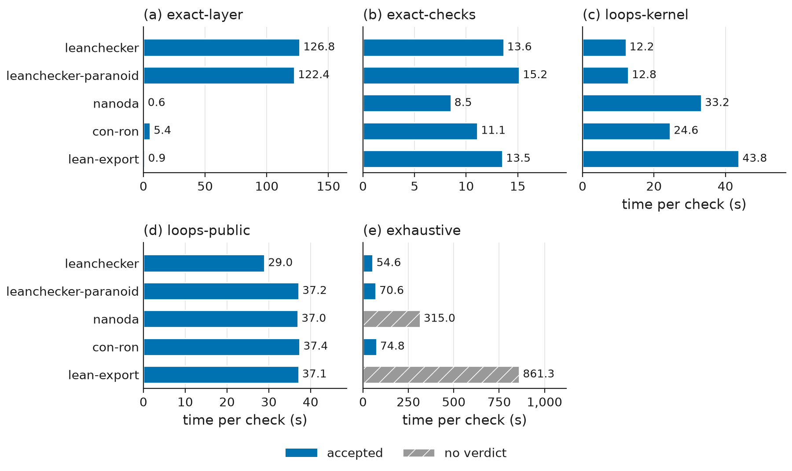

# Kernel time of floating-point operations

These tables record what Lean's kernel, the proof checker, spends on one operation and on whole theorems, as written and on the kernel path. They are written by the timing mode of `benchmarks/plots/figures.py` on one shared machine (Intel Xeon Platinum 8275CL @ 3.00GHz, 96 threads, shared with other jobs), so read them as ratios; `../figures/measured.json` has the exit code and the time of every section. Nothing here times compiled code. The figures `kernel-binary`, `kernel-operands`, `kernel-extras`, `kernel-loops` and `kernel-all-pairs` of [`../FIGURES.md`](../FIGURES.md) draw them.

- As written: the public operations of FloatLib (`+`, `-`, `*`, `/`, `ExecFloat.sqrt`, `ExecFloat.fma`), as the kernel reduces them without the kernel path. The kernel path does not change these operations. For E4M3 and E5M2 these rows are the reference operations `ExecFloat.Spec.*`, because the kernel cannot evaluate their public operations: they look answers up in tables of 65,536 entries, and building one table in the kernel ran out of 16 GB after about 220 seconds.
- Kernel path: the operations `KernelPath.Value.*` in the nearest-even direction, rewritten as `float_decide` rewrites a goal (the rules tagged `@[kernel_optimize]`), so a cell is the operation that the kernel checks in a proof by `float_decide`.
- A cell is (time of the operation over the operand table - time of a no-operation over the same table) / number of triples, the fastest run of `Lean.Kernel.whnf`, in microseconds. `benchmarks/kernel/run.sh` produces the cells.
- Square roots are taken of positive operands in the normal and subnormal classes. The special class mixes zeros, the smallest subnormal, one, the largest finite value, infinities and NaNs.
- The operand tables are hard on sums: the two operands of a sum have exponents within four binades of each other and their signs alternate, so half of the sums cancel leading bits or carry. The step of an accumulation loop, a sum of two values of one sign that keeps the exponent of the larger operand, is cheaper: see the loop theorems below.

## Eight triples per cell

`benchmarks/kernel/run.sh public 8 3` (as written, 2026-11-20, Lean v4.36.0), `spec 8 3 e4m3 e5m2` (2026-11-20, Lean v4.36.0) and `kernel 8 3` (kernel path, 2026-11-20, Lean v4.36.0). The as-written cells read and store encodings with the public conversions of each format, the kernel-path cells with `KernelPath.ofNat` and `KernelPath.toNat`. One-time work (format constants) is spread over eight operations only. The ratio is as written over kernel path.

| format | operands | | add | sub | mul | div | sqrt | fma |
| --- | --- | --- | ---: | ---: | ---: | ---: | ---: | ---: |
| binary16 | normal | as written | 3,891 | 3,985 | 3,598 | 6,794 | 5,046 | 5,047 |
| binary16 | normal | kernel path | 132 | 120 | 70 | 83 | 80 | 122 |
| binary16 | normal | ratio | 29x | 33x | 51x | 82x | 63x | 41x |
| binary16 | subnormal | as written | 4,005 | 4,227 | 2,446 | 2,903 | 5,117 | 5,677 |
| binary16 | subnormal | kernel path | 107 | 115 | 127 | 109 | 100 | 118 |
| binary16 | subnormal | ratio | 37x | 37x | 19x | 27x | 51x | 48x |
| binary16 | special | as written | 2,455 | 2,076 | 2,132 | 2,331 | 2,390 | 3,008 |
| binary16 | special | kernel path | 250 | 230 | 179 | 161 | 114 | 207 |
| binary16 | special | ratio | 10x | 9x | 12x | 14x | 21x | 15x |
| bfloat16 | normal | as written | 3,483 | 3,494 | 3,440 | 4,582 | 4,088 | 4,619 |
| bfloat16 | normal | kernel path | 115 | 131 | 70 | 83 | 78 | 118 |
| bfloat16 | normal | ratio | 30x | 27x | 49x | 55x | 52x | 39x |
| bfloat16 | subnormal | as written | 3,367 | 3,434 | 2,234 | 2,639 | 3,922 | 5,257 |
| bfloat16 | subnormal | kernel path | 117 | 116 | 139 | 105 | 100 | 119 |
| bfloat16 | subnormal | ratio | 29x | 30x | 16x | 25x | 39x | 44x |
| bfloat16 | special | as written | 2,342 | 1,991 | 2,077 | 2,105 | 2,180 | 3,031 |
| bfloat16 | special | kernel path | 244 | 232 | 182 | 162 | 115 | 204 |
| bfloat16 | special | ratio | 10x | 9x | 11x | 13x | 19x | 15x |
| binary32 | normal | as written | 3,469 | 3,581 | 3,345 | 4,665 | 4,506 | 4,310 |
| binary32 | normal | kernel path | 120 | 121 | 67 | 81 | 78 | 121 |
| binary32 | normal | ratio | 29x | 30x | 50x | 58x | 58x | 36x |
| binary32 | subnormal | as written | 3,184 | 3,198 | 3,188 | 4,482 | 4,411 | 4,283 |
| binary32 | subnormal | kernel path | 108 | 116 | 122 | 106 | 99 | 122 |
| binary32 | subnormal | ratio | 29x | 28x | 26x | 42x | 45x | 35x |
| binary32 | special | as written | 2,066 | 1,932 | 1,675 | 1,893 | 1,852 | 2,602 |
| binary32 | special | kernel path | 248 | 234 | 182 | 159 | 116 | 209 |
| binary32 | special | ratio | 8x | 8x | 9x | 12x | 16x | 12x |
| binary64 | normal | as written | 3,004 | 2,956 | 2,481 | 12,022 | 8,082 | 4,917 |
| binary64 | normal | kernel path | 111 | 121 | 72 | 86 | 83 | 141 |
| binary64 | normal | ratio | 27x | 24x | 34x | 140x | 97x | 35x |
| binary64 | subnormal | as written | 6,818 | 7,056 | 3,006 | 7,953 | 8,210 | 4,225 |
| binary64 | subnormal | kernel path | 109 | 117 | 143 | 107 | 104 | 141 |
| binary64 | subnormal | ratio | 63x | 60x | 21x | 74x | 79x | 30x |
| binary64 | special | as written | 3,398 | 2,857 | 3,295 | 3,628 | 3,178 | 4,713 |
| binary64 | special | kernel path | 262 | 244 | 187 | 163 | 122 | 236 |
| binary64 | special | ratio | 13x | 12x | 18x | 22x | 26x | 20x |
| binary128 | normal | as written | 4,328 | 4,248 | 6,508 | 20,788 | 115,320 | 12,304 |
| binary128 | normal | kernel path | 119 | 129 | 76 | 90 | 90 | 196 |
| binary128 | normal | ratio | 36x | 33x | 86x | 231x | 1,281x | 63x |
| binary128 | subnormal | as written | 9,557 | 8,912 | 3,974 | 3,261 | 12,813 | 28,825 |
| binary128 | subnormal | kernel path | 115 | 123 | 163 | 116 | 118 | 193 |
| binary128 | subnormal | ratio | 83x | 72x | 24x | 28x | 109x | 149x |
| binary128 | special | as written | 4,702 | 3,497 | 4,038 | 4,511 | 33,631 | 8,201 |
| binary128 | special | kernel path | 414 | 367 | 312 | 268 | 223 | 439 |
| binary128 | special | ratio | 11x | 10x | 13x | 17x | 151x | 19x |
| e4m3 | normal | as written | 2,961 | 2,725 | 2,281 | 2,540 | 3,722 | 3,499 |
| e4m3 | normal | kernel path | 113 | 123 | 66 | 80 | 75 | 119 |
| e4m3 | normal | ratio | 26x | 22x | 35x | 32x | 50x | 29x |
| e4m3 | subnormal | as written | 1,983 | 2,133 | 2,040 | 2,289 | 3,578 | 3,398 |
| e4m3 | subnormal | kernel path | 126 | 114 | 109 | 99 | 95 | 122 |
| e4m3 | subnormal | ratio | 16x | 19x | 19x | 23x | 38x | 28x |
| e4m3 | special | as written | 1,310 | 1,320 | 921 | 995 | 1,606 | 1,301 |
| e4m3 | special | kernel path | 141 | 138 | 115 | 120 | 77 | 131 |
| e4m3 | special | ratio | 9x | 10x | 8x | 8x | 21x | 10x |
| e5m2 | normal | as written | 3,352 | 3,555 | 3,066 | 2,281 | 3,897 | 4,636 |
| e5m2 | normal | kernel path | 118 | 127 | 66 | 81 | 75 | 119 |
| e5m2 | normal | ratio | 28x | 28x | 46x | 28x | 52x | 39x |
| e5m2 | subnormal | as written | 3,063 | 3,110 | 2,911 | 2,231 | 2,933 | 4,243 |
| e5m2 | subnormal | kernel path | 121 | 144 | 129 | 100 | 75 | 120 |
| e5m2 | subnormal | ratio | 25x | 22x | 23x | 22x | 39x | 35x |
| e5m2 | special | as written | 1,857 | 1,920 | 1,256 | 1,116 | 1,792 | 1,824 |
| e5m2 | special | kernel path | 244 | 225 | 174 | 157 | 112 | 197 |
| e5m2 | special | ratio | 8x | 9x | 7x | 7x | 16x | 9x |

## Sixty-four triples per cell, the same conversions on both sides

Both sides read and store encodings with `KernelPath.ofNat` and `KernelPath.toNat` (`KERNEL_BENCH_CONVERSIONS=kernel`), so a cell is the operation alone, and one-time work is spread over 64 operations: `run.sh public 64 2` (2026-11-20, Lean v4.36.0), `spec 64 2 e4m3 e5m2` and `kernel 64 5` (2026-11-20, Lean v4.36.0). The special class is left out: it has nine distinct triples, and the kernel remembers a repeated computation. The subnormal rows of E5M2 are too low on both sides for the same reason (three subnormal fractions).

| format | operands | | add | sub | mul | div | sqrt | fma |
| --- | --- | --- | ---: | ---: | ---: | ---: | ---: | ---: |
| binary16 | normal | as written | 4,520 | 4,351 | 4,030 | 8,499 | 5,544 | 5,947 |
| binary16 | normal | kernel path | 81 | 91 | 57 | 71 | 65 | 108 |
| binary16 | normal | ratio | 56x | 48x | 71x | 120x | 85x | 55x |
| binary16 | subnormal | as written | 4,518 | 4,458 | 2,304 | 2,750 | 5,760 | 6,378 |
| binary16 | subnormal | kernel path | 84 | 94 | 110 | 90 | 89 | 105 |
| binary16 | subnormal | ratio | 54x | 47x | 21x | 31x | 65x | 61x |
| bfloat16 | normal | as written | 4,298 | 4,293 | 3,763 | 5,654 | 4,938 | 5,176 |
| bfloat16 | normal | kernel path | 79 | 91 | 52 | 68 | 62 | 103 |
| bfloat16 | normal | ratio | 54x | 47x | 72x | 83x | 80x | 50x |
| bfloat16 | subnormal | as written | 3,494 | 3,572 | 2,245 | 2,572 | 4,963 | 5,623 |
| bfloat16 | subnormal | kernel path | 81 | 94 | 102 | 93 | 83 | 110 |
| bfloat16 | subnormal | ratio | 43x | 38x | 22x | 28x | 60x | 51x |
| binary32 | normal | as written | 5,059 | 5,118 | 4,209 | 5,461 | 6,773 | 5,329 |
| binary32 | normal | kernel path | 84 | 90 | 55 | 71 | 63 | 115 |
| binary32 | normal | ratio | 60x | 57x | 77x | 77x | 108x | 46x |
| binary32 | subnormal | as written | 3,726 | 3,676 | 3,503 | 5,122 | 5,179 | 4,971 |
| binary32 | subnormal | kernel path | 88 | 94 | 109 | 91 | 88 | 125 |
| binary32 | subnormal | ratio | 42x | 39x | 32x | 56x | 59x | 40x |
| binary64 | normal | as written | 3,325 | 3,227 | 2,505 | 15,709 | 9,278 | 5,654 |
| binary64 | normal | kernel path | 77 | 87 | 56 | 72 | 69 | 135 |
| binary64 | normal | ratio | 43x | 37x | 45x | 218x | 134x | 42x |
| binary64 | subnormal | as written | 8,269 | 9,036 | 3,581 | 10,278 | 10,907 | 5,281 |
| binary64 | subnormal | kernel path | 86 | 98 | 141 | 98 | 95 | 136 |
| binary64 | subnormal | ratio | 96x | 92x | 25x | 105x | 115x | 39x |
| binary128 | normal | as written | 5,187 | 6,157 | 8,116 | 23,384 | 123,574 | 14,530 |
| binary128 | normal | kernel path | 85 | 98 | 63 | 81 | 80 | 192 |
| binary128 | normal | ratio | 61x | 63x | 129x | 289x | 1,545x | 76x |
| binary128 | subnormal | as written | 11,348 | 10,473 | 4,458 | 3,331 | 15,335 | 34,453 |
| binary128 | subnormal | kernel path | 89 | 99 | 156 | 107 | 106 | 190 |
| binary128 | subnormal | ratio | 128x | 106x | 29x | 31x | 145x | 181x |
| e4m3 | normal | as written | 2,636 | 2,712 | 2,340 | 2,538 | 3,814 | 3,635 |
| e4m3 | normal | kernel path | 77 | 84 | 51 | 67 | 64 | 100 |
| e4m3 | normal | ratio | 34x | 32x | 46x | 38x | 60x | 36x |
| e4m3 | subnormal | as written | 1,650 | 1,862 | 1,390 | 1,650 | 3,339 | 2,469 |
| e4m3 | subnormal | kernel path | 77 | 84 | 78 | 64 | 69 | 77 |
| e4m3 | subnormal | ratio | 21x | 22x | 18x | 26x | 48x | 32x |
| e5m2 | normal | as written | 3,509 | 3,442 | 3,033 | 2,251 | 3,948 | 4,557 |
| e5m2 | normal | kernel path | 80 | 82 | 49 | 67 | 62 | 98 |
| e5m2 | normal | ratio | 44x | 42x | 62x | 34x | 64x | 46x |
| e5m2 | subnormal | as written | 523 | 523 | 974 | 717 | 340 | 1,441 |
| e5m2 | subnormal | kernel path | 23 | 25 | 42 | 33 | 10 | 41 |
| e5m2 | subnormal | ratio | 23x | 21x | 23x | 22x | 34x | 35x |

## Wide and custom formats

The kernel path in two custom layouts (`e8f15`, 24 bits, and `e15f64`, 80 bits) and in the IEEE interchange formats of 256 to 4,096 bits (19, 23, 27 and 35 exponent bits), eight triples per cell, the fastest of three runs. The public operations are not measured at these widths.

| format | operands | add | sub | mul | div | sqrt | fma |
| --- | --- | ---: | ---: | ---: | ---: | ---: | ---: |
| e8f15 | normal | 123 | 125 | 69 | 84 | 68 | 135 |
| e8f15 | subnormal | 106 | 119 | 121 | 107 | 100 | 120 |
| e8f15 | special | 248 | 235 | 184 | 161 | 114 | 209 |
| e15f64 | normal | 117 | 131 | 76 | 90 | 89 | 164 |
| e15f64 | subnormal | 110 | 121 | 152 | 111 | 113 | 157 |
| e15f64 | special | 299 | 277 | 233 | 208 | 154 | 311 |
| binary256 | normal | 126 | 141 | 76 | 92 | 91 | 212 |
| binary256 | subnormal | 127 | 129 | 208 | 127 | 125 | 201 |
| binary256 | special | 448 | 403 | 396 | 270 | 224 | 451 |
| binary512 | normal | 141 | 149 | 76 | 91 | 162 | 223 |
| binary512 | subnormal | 140 | 151 | 217 | 177 | 199 | 217 |
| binary512 | special | 452 | 423 | 365 | 312 | 278 | 473 |
| binary1024 | normal | 145 | 152 | 77 | 93 | 207 | 229 |
| binary1024 | subnormal | 145 | 157 | 244 | 176 | 278 | 237 |
| binary1024 | special | 472 | 453 | 374 | 328 | 304 | 488 |
| binary4096 | normal | 156 | 158 | 82 | 104 | 283 | 258 |
| binary4096 | subnormal | 159 | 169 | 252 | 199 | 390 | 252 |
| binary4096 | special | 485 | 463 | 402 | 350 | 334 | 523 |

The cost grows slowly with the width: the short paths of addition and multiplication do not look at the width, a normal significand has its bit length after one comparison, the general rounding finds a bit length beyond 384 bits by a search down to a window of 128 bits, and the square root takes sixteen Newton steps when eight do not pass its check. No sum, no rounding and no quotient builds a power of two of the size of an exponent difference, so a sum with a zero, a product far below the subnormal range and a quotient of operands at the two ends of the range cost the same at every exponent width (`KernelPath.divCore_def` for the quotient). The operations with status flags still put the exact result on a grid of absolute exponents; they are meant for formats up to binary256.

## Outcomes with status flags, comparisons, conversions and literals

`benchmarks/kernel/extras.sh 64 5` (2026-11-20, Lean v4.36.0) reduces one term per row twice: as written, through the public operations, and after the rewrite that `float_decide` applies. Microseconds per operation on normal operands, 64 operand triples or literals per cell, the fastest of five runs. A row with `status := true` evaluates the delivered value, the comparison of the flags with a record and the comparison of the ternary value with a constant, as a statement about an outcome does. The cast rows are the reference cast `Model.cast` of a decoded value, stored in the destination format; the public conversion `x.cast (target := T)` is not rewritten. The rational numbers are `mkRat (2 * i + 1) (3 * i + 7)`, and the time the kernel needs to build them is subtracted on both sides. `n/a` is a cell whose difference came out at zero or below, which happens to the cheapest terms on a busy machine.

| term | binary32 as written | binary32 rewritten | ratio | binary64 as written | binary64 rewritten | ratio |
| --- | ---: | ---: | ---: | ---: | ---: | ---: |
| `ExecFloat.Binary.add x y (status := true)` | 12,238 | 306 | 40x | 12,962 | 276 | 47x |
| `ExecFloat.Binary.sub x y (status := true)` | 13,497 | 289 | 47x | 13,460 | 297 | 45x |
| `ExecFloat.Binary.mul x y (status := true)` | 12,073 | 232 | 52x | 13,636 | 234 | 58x |
| `ExecFloat.Binary.div x y (status := true)` | 7,304 | 254 | 29x | 7,123 | 274 | 26x |
| `ExecFloat.Binary.sqrt x (status := true)` | 10,399 | 204 | 51x | 18,172 | 214 | 85x |
| `ExecFloat.Binary.fma x y z (status := true)` | 15,343 | 335 | 46x | 19,558 | 345 | 57x |
| `ExecFloat.Binary.roundToIntegral x .nearest (status := true)` | 7,684 | 250 | 31x | 9,406 | 254 | 37x |
| `x < y` | 2,209 | 69 | 32x | 2,592 | 72 | 36x |
| `x == y` | 2,266 | 56 | 40x | 2,538 | 56 | 46x |
| `ExecFloat.Binary.totalOrder x y` | 1,848 | 67 | 28x | 2,230 | 67 | 33x |
| `ExecFloat.Binary.isNaN x` | 116 | 31 | 4x | 108 | 30 | 4x |
| `ExecFloat.Binary.roundToIntegral x .nearest` | 5,023 | 74 | 68x | 5,708 | 75 | 76x |
| `x.toInt? (mode := .nearest)` | 851 | 75 | 11x | 771 | 76 | 10x |
| `ExecFloat.Binary.toRat? x` | 636 | 118 | 5x | 615 | 119 | 5x |
| `Model.cast` into the next narrower format, between a decode and a store | 4,913 | 65 | 76x | 6,299 | 68 | 93x |
| the same cast with `status := true` | 9,686 | 258 | 38x | 12,587 | 265 | 47x |
| a decimal literal `(2 * i + 1) / 1000` | 1,994 | 78 | 26x | 2,214 | 77 | 29x |
| `ExecFloat.Binary.ofRat q (mode := .up)` | 2,117 | 294 | 7x | 2,295 | 287 | 8x |
| `ExecFloat.Binary.ofRat q (mode := .up) (status := true)` | 5,744 | 522 | 11x | 5,731 | 530 | 11x |

## Three theorems about loops of 1,000 steps

`benchmarks/kernel/loops.sh 3` (2026-11-20, Lean v4.36.0) type-checks each theorem of `Loops.lean` three times by `decide +kernel` on the public operations and by `float_decide`, and prints the `type checking` time of Lean's profiler; the table has the fastest run. `FlocqConversion.v` states the same three results for Coq 8.20.1 with Flocq 4.2.2; its two columns are the `Time Qed` lines recorded on 2026-11-15 in the container `leanfloat-flocq-bench:4.2.2` (8 GB, 2 CPUs).

| theorem | `decide +kernel`, public operations | `float_decide` | Coq, kernel conversion (recorded) | Coq, bytecode VM (recorded) |
| --- | ---: | ---: | ---: | ---: |
| 1,000 binary32 additions of 0.1 | 4.33 s | 0.053 s | 0.381 s | 0.058 s |
| sum of 1,000 binary64 values | 4.46 s | 0.100 s | 4.56 s | 0.327 s |
| dot product of 1,000 binary64 pairs | 8.25 s | 0.152 s | 9.35 s | 0.73 s |

The `float_decide` column is the kernel's check of the loop. Each proof has two more lemmas, the rewrite of the goal and the statement itself, which the kernel checks in milliseconds. Each Lean theorem depends on `propext`, `Classical.choice` and `Quot.sound` only (the `axioms` column of `loops.csv`). The Coq file computes the binary64 operands once with `vm_compute` and stores them as lists, so that its conversions contain floating-point operations only; Lean computes the operands inside the kernel.

## Statements about all 65,536 pairs of encodings

Seconds of kernel time to check one statement about all pairs (2026-11-20, Lean v4.36.0): the loop of `float_decide` over the pairs (`benchmarks/kernel/Exhaustive.lean`: addition and multiplication of E4M3 commute on all pairs of encodings that are not both NaN), and one run of each side on rows of 65,536 lanes (`lane_decide`, `benchmarks/suite/Lanes.lean`), where the time is the sum over the lane widths that were tried.

| statement | method | seconds | lane widths tried |
| --- | --- | ---: | ---: |
| e4m3 add-commutes | float_decide loop | 18.60 |  |
| e4m3 mul-commutes | float_decide loop | 23.40 |  |
| e4m3 add-commutes | lane_decide | 2.40 | 2 |
| e4m3 mul-commutes | lane_decide | 0.76 | 1 |
| e5m2 add-commutes | lane_decide | 1.92 | 2 |
| e5m2 mul-commutes | lane_decide | 1.59 | 2 |
| binary16-slice add-commutes | lane_decide | 3.57 | 3 |
| binary16-slice mul-commutes | lane_decide | 1.54 | 2 |
| e4m3 add-table | lane_decide | 3.11 | 2 |

<!-- figures: this section is written by benchmarks/plots/figures.py draw -->

## Figures

The captions, alt texts, notes and CSV columns of these figures are in [FIGURES.md](../FIGURES.md).

.")

**Figure 1.** Kernel time of one binary operation of FloatLib from 8 to 4,096 bits, as written and on the kernel path. A point is the time Lean's kernel takes for one operation on normal operands, rounded to nearest even, as the median over the formats of that width; as written is the public operation, and the kernel path is the term that float_decide checks. Both axes are logarithmic, lower is faster, and the public operations were not measured above 128 bits. Measured with Lean v4.36.0 (Intel Xeon Platinum 8275CL @ 3.00GHz, 96 threads, shared with other jobs, 2026-11-20).

.")

**Figure 2.** Kernel time of one operation of FloatLib by operand class: normal operands, subnormal operands and special values. A point is the time Lean's kernel takes for one operation on the kernel path, as the median over the formats of that width. The width axis is logarithmic, and lower is faster. Measured with Lean v4.36.0 (Intel Xeon Platinum 8275CL @ 3.00GHz, 96 threads, shared with other jobs, 2026-11-20).

, as written and with FloatLib's kernel rules. A mark is the time Lean's kernel takes for one evaluation on normal operands; as written goes through the public operation, and the other mark is the term after the rewrite of float_decide. The time axis is logarithmic, and lower is faster. Measured with Lean v4.36.0 (Intel Xeon Platinum 8275CL @ 3.00GHz, 96 threads, shared with other jobs, 2026-11-20).")

**Figure 3.** Kernel time of the terms beyond the six operations (status flags, comparisons, conversions, casts and literals), as written and with FloatLib's kernel rules. A mark is the time Lean's kernel takes for one evaluation on normal operands; as written goes through the public operation, and the other mark is the term after the rewrite of float_decide. The time axis is logarithmic, and lower is faster. Measured with Lean v4.36.0 (Intel Xeon Platinum 8275CL @ 3.00GHz, 96 threads, shared with other jobs, 2026-11-20).

; the Coq times were recorded on 2026-11-15 in a container with 8 GB and two CPUs.")

**Figure 4.** Time to check a theorem about a loop of 1,000 floating-point operations: FloatLib by decide +kernel and by float_decide, and Flocq 4.2.2 in Coq 8.20.1. A mark is the time the proof checker spends on a theorem that states the encoding of the loop's result. The time axis is logarithmic, and lower is faster. Measured with Lean v4.36.0 (Intel Xeon Platinum 8275CL @ 3.00GHz, 96 threads, shared with other jobs, 2026-11-20); the Coq times were recorded on 2026-11-15 in a container with 8 GB and two CPUs.

**Figure 5.** Time the independent checkers of Lean proofs take on the kernel proofs of FloatLib, by family of proofs. A bar is the time of one check of a family with everything it imports, and a hatched bar is a run that ended without a verdict, at the time it stopped. The checkers ran once, and the timing mode does not run them again.

<!-- end of figures -->
